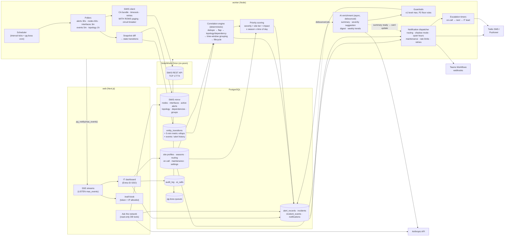
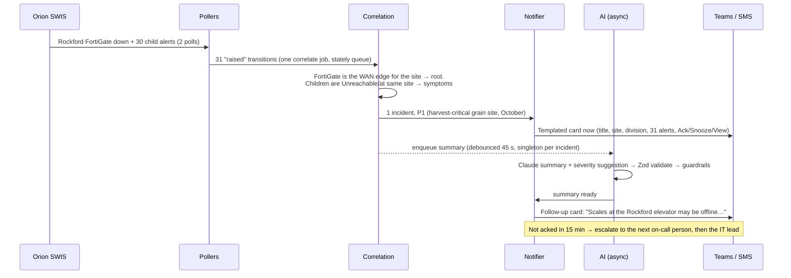

# MercerAlertService — Architecture

Status: design baseline (Milestone 0). Owner: Mercer Landmark IT.

## 1. What this is

SolarWinds Orion/NPM keeps doing all device polling. MercerAlertService (MAS) reads
Orion through the SWIS REST API, turns the raw alert stream into a few clear,
prioritized incidents, and delivers them to Teams, SMS and push. It also gives the
IT team a live dashboard and a NOC wall display.

Design rules. Every later decision follows from these:

1. **SWIS is the only device data source.** MAS never polls a device directly.
2. **Deterministic first.** Code decides whether an incident exists, how alerts group,
   and whether a notification goes out. AI only enriches the result: summaries,
   suggestions and digests.
3. **AI is never on the critical path.** If the Anthropic API is slow, down or over
   budget, incidents still form and templated notifications still go out. The AI
   summary is attached when it arrives.
4. **Store transitions, not polls.** We store current snapshots, state changes and
   5-minute metric rollups. We don't keep every poll result.
5. **Fail loud.** If SWIS, the worker, a notifier or the AI budget fails, MAS raises
   its own visible signal: an incident, a banner, or the wall's "DATA STALE" banner.
6. **Shadow mode first.** A single flag sends every outbound message to one test
   Teams channel, so MAS can run alongside the existing SolarWinds emails before cutover.

## 2. Components

| Service (Compose) | Process                        | Responsibilities                                                                                                                                                                                    |
| ----------------- | ------------------------------ | --------------------------------------------------------------------------------------------------------------------------------------------------------------------------------------------------- |
| `init`            | one-shot (worker image, root)  | Generates the bootstrap secrets once into the `bootstrap` volume: DB password, `database_url` and the **master key** that encrypts secrets saved in the web UI. It never overwrites existing files. |
| `db`              | PostgreSQL 16                  | All state: SWIS mirror, transitions, incidents, config, audit, pg-boss queues (`pgboss` schema). Named volume `pgdata`.                                                                             |
| `migrate`         | one-shot (worker image)        | Applies Drizzle SQL migrations, then exits. `web` and `worker` wait for it to complete.                                                                                                             |
| `worker`          | Node (long-running)            | SWIS polling, correlation, scoring, AI calls, notifications, escalations, digests, retention, self-monitoring, heartbeat. Exposes `:9090/healthz` for the container healthcheck.                    |
| `web`             | Next.js (App Router)           | IT dashboard (Entra SSO), admin, "Ask the network" chat API, SSE streams, `/wall` kiosk, `/api/health`. **Does no polling.**                                                                        |
| `backup`          | postgres:16-alpine + cron loop | Nightly `pg_dump -Fc` to the `backups` volume, with rotation.                                                                                                                                       |
| `mock-swis`       | Node (dev/CI profile only)     | Fake SWIS that serves a synthetic Mercer-like world or recorded fixtures, with a control API for scenarios, plus Teams/Twilio/Pushover sinks for notification tests.                                |

Monorepo packages (pnpm workspaces, TypeScript everywhere):

```
apps/web          Next.js UI + API routes + SSE
apps/worker       pg-boss job handlers, pollers, scheduler, health server
packages/core     domain types, config (zod env), logger, status/role/site mapping,
                  correlation + scoring + guardrails (pure, heavily unit-tested)
packages/db       Drizzle schema, migrations, repositories, seed data
packages/swis     SWIS client (TLS/CA, retries, circuit breaker, WITH ROWS paging),
                  SWQL query catalog, row schemas, schema probe, discovery
packages/notify   (M4) Notifier interface; Teams Workflows, Twilio, Pushover providers
packages/ai       (M5) Anthropic client wrapper, prompts, schemas, budget, redaction
tools/mock-swis   mock SWIS server + synthetic world generator
tools/simulator   (M2) scenario CLI that replays storms and asserts outcomes
scripts/          swis-discover.ts, swis-record.ts, dev helpers
```

## 3. Data flow



### Alert storm, end to end (target behavior)



## 4. Worker jobs

Pollers run on **interval ticks**, which support sub-minute periods such as 30 s, and
push into pg-boss queues that use the `stately` policy: at most one queued job and one
active job per queue. A slow SWIS therefore can never pile up overlapping polls, and
several worker replicas cannot double-poll. Wall-clock jobs use pg-boss cron with the
`America/New_York` time zone.

| Queue                       | Trigger                                                                                                                 | Policy    | Milestone |
| --------------------------- | ----------------------------------------------------------------------------------------------------------------------- | --------- | --------- |
| `swis.poll.alerts`          | every 30 s                                                                                                              | stately   | M1        |
| `swis.poll.nodes`           | every 60 s                                                                                                              | stately   | M1        |
| `swis.poll.interfaces`      | every 180 s                                                                                                             | stately   | M1        |
| `swis.poll.events`          | every 300 s                                                                                                             | stately   | M1        |
| `swis.poll.groups`          | every 300 s: groups, members, site-group links and site notes (group descriptions)                                      | stately   | ✓         |
| `swis.poll.topology`        | every 3600 s, and at startup                                                                                            | stately   | M1        |
| `maint.retention`           | cron `15 3 * * *` ET                                                                                                    | singleton | M1        |
| `correlate.run`             | after any poll that produced transitions, plus every 30 s (lifecycle: hold-down, reopen/close, snooze, maintenance)     | stately   | M2 ✓      |
| `swis.writeback.ack`        | when someone acknowledges in MAS and `SWIS_WRITEBACK_ENABLED` is on (2 retries)                                         | standard  | M3 ✓      |
| `swis.writeback.note`       | when someone adds a note to an incident with active Orion alerts (`AppendNote`, 2 retries)                              | standard  | ✓         |
| `swis.writeback.site-notes` | when site notes of a site linked to a SolarWinds group are edited in MAS (no retries; outcome in `site_notes_writes`)   | standard  | ✓         |
| `notify.run`                | after each correlation cycle, when the dashboard changes an incident, and every 15 s: dispatch, due escalations, outbox | stately   | M4 ✓      |
| `notify.test`               | Settings → Send test (the web request waits for the result)                                                             | standard  | M4 ✓      |
| `ai.incident.summary`       | after each correlation cycle and every 30 s, per incident that needs it (`singletonKey`, `startAfter` 45 s)             | stately   | M5 ✓      |
| `ai.digest.daily`           | cron `DIGEST_DAILY_CRON` (`0 7 * * *` ET), or Settings → Digests → Send now                                             | singleton | M5 ✓      |
| `ai.digest.weekly`          | cron `DIGEST_WEEKLY_CRON` (`30 7 * * 1` ET), or Send now                                                                | singleton | M5 ✓      |
| `ai.test`                   | Settings → AI → Test (the web request waits for the result)                                                             | standard  | M5 ✓      |
| `ai.chat`                   | each "Ask the network" question (3 in parallel per worker; stale pending answers are failed after 6 min)                | standard  | M6 ✓      |
| `maint.selfcheck`           | every 60 s: failing notifiers, overdue outbox, correlation backlog                                                      | singleton | M4 ✓      |

## 5. SWIS integration

- Endpoint `https://<orion>:17774/SolarWinds/InformationService/v3/Json/Query`, using
  POST `{query, parameters}` and Basic auth with a dedicated **read-only** Orion account.
  Parameters are always bound (`@name`). We never interpolate strings. The only inlined
  values are validated integers in `WITH ROWS a TO b` and identifiers checked against
  `^[A-Za-z_][A-Za-z0-9_]*$` (custom property names).
- **TLS:** `SWIS_CA_CERT_PATH` points to a PEM bundle, which is how Orion's self-signed
  certificate is trusted. `SWIS_TLS_SERVERNAME` can override SNI and hostname
  verification, for example when connecting by IP to a certificate issued for the FQDN.
  `SWIS_TLS_INSECURE_SKIP_VERIFY_DEV_ONLY=true` turns verification off. It logs at
  **error** level at startup and every 10 minutes, shows on `/api/health`, and is meant
  for development only.
- **Resilience:** per-request timeout (default 20 s). Up to 3 retries with exponential
  backoff and jitter on network errors, 408, 429 and 5xx. No retry on 400 (a SWQL
  error) or 401/403. A circuit breaker opens after 5 consecutive failures and moves to
  half-open after 30 s. While it is open, polls are recorded as `skipped_circuit_open`.
- **Paging:** `ORDER BY <key> WITH ROWS n TO m` (default page 1000) for snapshot
  queries. Event and alert-history queries are incremental: `WHERE ID > @cursor`, with
  `WITH ROWS 1 TO n` as the page limit.
- **Schema probe:** at startup and hourly, the worker reads `Metadata.Property` for every
  entity we query. Optional fields that are missing in this Orion version are dropped
  from the SELECT with a warning. A missing required field fails that poller with a clear
  error. Custom-property columns are discovered from `Metadata.Property` on
  `Orion.NodesCustomProperties`.
- **Monitoring source down:** if the breaker opens, or the last successful alert poll is
  older than `SWIS_STALE_AFTER_SEC` (default 120 s), the worker writes a `source down`
  transition. The correlation engine (M2) turns that into a fixed **P1 "Monitoring source
  down"** incident. Notifications don't depend on SWIS, so this incident still goes out.
- **Write-back (off by default):** when `SWIS_WRITEBACK_ENABLED=true` and the separate
  `SWIS_WRITE_USERNAME`/`SWIS_WRITE_PASSWORD` account is configured, acknowledging an
  incident in MAS invokes `Orion.AlertActive.Acknowledge` for the member alerts'
  AlertObjectIDs. The read-only client never gets these credentials.

The full query list is in [swql-queries.md](swql-queries.md).

## 6. Storage model

Three layers. Full schema: [schema.md](schema.md).

1. **Mirror (current state):** `orion_nodes`, `orion_interfaces`, `orion_active_alerts`,
   topology, dependencies and groups. These are upserted from each successful **complete**
   fetch. A failed or partial fetch never deletes rows and never "clears" alerts.
2. **History:** `entity_transitions` (alert raised, cleared, retriggered or acked; node and
   interface status changes; source up/down). There are also 5-minute rollups
   (`node_metrics_5m`, `interface_metrics_5m`, upserted with running avg and max) and the
   Orion `events` and `alert_history` streams. Retention is 90 days by default.
3. **Derived:** `alert_records` (deduped per alert rule + entity), `incidents`,
   `incident_members` and `incident_events`, plus notifications, digests and AI call logs.
   Incidents are kept for 2 years.

All timestamps are `timestamptz` stored in UTC. Business logic (business hours, harvest
season, digests) runs in `APP_TIMEZONE`, default `America/New_York`.

## 7. Correlation & priority (implemented in M2)

The engine (`packages/core/src/correlation`) is a pure function. The worker's
`correlate.run` job loads a snapshot from Postgres, runs the engine, and persists the result
in one transaction under an advisory lock. The snapshot holds pending transitions, the
mirror, the topology graph, open and recently resolved incidents, active alert records,
seasons, maintenance windows and recent flap history. The job runs after every poll that
recorded changes, and every 30 s as the lifecycle tick.

1. **Dedupe.** One `alert_record` per `(AlertID, EntityUri)`. A re-trigger increments
   `trigger_count`. Orion node status adds `status:node:<id>` records: _down_ is critical,
   and _unreachable_ is a symptom only. SWIS itself adds `internal:source:swis`.
2. **Flapping.** A device or interface with at least `FLAP_COUNT` state changes in
   `FLAP_WINDOW_MIN` becomes, or joins, one flapping incident. Consecutive changes in the same
   direction count once, so a status change plus its "Node is down" alert is one change. A
   flapping incident resolves after the device has been stable for the whole flap window.
3. **Grouping.** A new problem joins an open incident if any of these holds:
   - the incident is at the same site and was active within `CORRELATION_WINDOW_SEC`;
   - the problem's upstream root is the root of an ongoing outage, at any site; or
   - the problem has no site but is on the same node, within the window.

   Otherwise a new incident opens. An old standing alert on a device never pulls a new storm
   into its incident.

4. **Root cause.** Walk upstream through down or unreachable parents. Parents come from Orion
   dependencies (a parent group's members expanded) and from topology links, which are
   oriented by device role. If neither exists, fall back to the site's down WAN-edge firewall.
   A device with an active "node down" alert counts as down even before the next node poll.
5. **Classification.**
   - `site_outage`: the root is the site firewall, or every managed node at the site is down
     or unreachable.
   - `ups_power`: a UPS node is involved, or an alert name matches `UPS_ALERT_REGEX`.
   - `device_down`, `interface`, `service` and `generic` cover the rest.
   - `flapping` and `monitoring_source_down` are fixed by how the incident was formed.

   Members get the role root, symptom or member. Titles and summaries come from
   deterministic business-language templates, for example "Scales at Coldwater Elevator may be
   offline".

6. **Lifecycle.** `open → acknowledged → resolved → closed`.
   - Auto-resolve after all members have been clear for `RESOLVE_HOLDDOWN_SEC`.
   - Reopen if a member returns within `REOPEN_WINDOW_SEC`; close after that.
   - Snooze expiry is handled on the lifecycle tick.
   - A maintenance window that suppresses "notifications" sets `in_maintenance`. One that
     suppresses "incidents" holds alerts back until the window ends, then raises them if
     they are still active.
7. **Seeding and reconcile.** Alerts already active when MAS starts are marked `seeded`. They
   don't count towards the noise ratio, and M4 won't page for them. Once per monitoring
   start, after both alerts and nodes have been polled, records are reconciled against the
   mirror. This also covers upgrades, because backlog older than `CORRELATION_MAX_AGE_SEC` is
   skipped rather than replayed.
8. **Noise ratio.** Raw Orion alert raises (excluding initial sync) ÷ non-seeded incidents
   opened. The status page shows it for 24 h and 7 d.

**Priority** comes from a deterministic score, and every factor is stored in
`incidents.priority_factors`:

```
score = impact points × Orion severity × site tier × season × time of day
  impact:   whole site 70 · firewall / core switch / scale system 50 · router 45 · server 40
            · power/UPS 40 · interface on a core device 40 · switch 35 · AP 25 · other interface 20
            · several devices = worst + 10 (max 60)
  severity: critical 1.0 · serious 0.85 · warning 0.6 · notice 0.4 · informational 0.25
  tier:     critical 1.4 · high 1.2 · standard 1.0                        (Settings → Correlation)
  season:   harvest at a harvest-critical site → Harvest multiplier (1.5); harvest at other grain
            sites 1.2; other periods by division                         (Settings → Seasons)
  time:     outside the site's business hours (harvest hours in harvest) 0.8 — not applied to
            site outages / firewall down at harvest-critical sites during harvest
P1 ≥ 70 · P2 ≥ 50 · P3 ≥ 30 · else P4; "Monitoring source down" is always P1.
```

Settings → Correlation shows live examples computed from the saved settings. The simulator
(`pnpm simulate`) asserts these outcomes end to end, through the real pollers, correlation,
notification dispatcher and HTTP delivery to the mock's Teams and Twilio sinks:

| Scenario                                                    | Incident                                                                     | Routing (default rules, nobody acknowledges)      | AI (fake model)               |
| ----------------------------------------------------------- | ---------------------------------------------------------------------------- | ------------------------------------------------- | ----------------------------- |
| Rockford FortiGate down with 30 child alerts, October 10:00 | **1** site outage, **P1**, 31 alerts, resolved after recovery, 31:1          | #net-critical; on-call paged; escalated at 15 min | ≤ 2 summaries (open, resolve) |
| Same outage in March at 22:00                               | **1** site outage, **P2**                                                    | #net-critical; paged (P2 after hours); escalated  | 1 summary                     |
| Flapping AP (6 bounces in 6 min)                            | **1** flapping incident, **P3**                                              | #net-alerts; no page                              | ≤ 2 (down, then flapping)     |
| UPS on battery at Coldwater in harvest                      | **1** power incident, **P2**                                                 | #net-critical; no page (business hours)           | ≤ 2 summaries (open, resolve) |
| HQ WAN link ramps to 98 %                                   | **1** interface incident, **P3**                                             | #net-alerts; no page                              | 1 summary                     |
| SWIS returns 503 for 5 min                                  | **1** "SolarWinds monitoring unavailable", **P1**, resolved after it returns | #net-critical; paged                              | ≤ 2 summaries (open, resolve) |

The **recovery target** is shown on each incident: 4 h for harvest-critical sites during
harvest, 8 h otherwise.

**AI severity guardrail** (`applyAiAdjustment`, already unit-tested). Claude can propose ±1
level, with a reason that is stored and displayed. AI can never lower a whole-site outage, a
firewall-down incident, or any harvest-critical site during harvest below **P2**. If such an
incident is already below P2, AI can't lower it at all. Monitoring-source-down is fixed.

## 8. AI layer (implemented in M5)

Claude only ever **enriches**. An incident, its priority and its templated Teams/SMS messages
exist before any AI runs. Every AI failure leaves the template in place, and the AI never decides
whether an alert exists or who is notified.

| Task                    | Queue / trigger                                                   | Default model                         | Effort | Output                                                                            |
| ----------------------- | ----------------------------------------------------------------- | ------------------------------------- | ------ | --------------------------------------------------------------------------------- |
| Priority second opinion | `ai.incident.summary` (with the summary)                          | `claude-haiku-5-5` (`AI_MODEL_FAST`)  | low    | `{adjust: -1\|0\|1, reason}`, then guardrails in code                             |
| Incident summary        | `ai.incident.summary`: on open and on material change, debounced  | `claude-opus-5-5` (`AI_MODEL_STRONG`) | medium | title, short, whatIsAffected, likelyCause + confidence, firstSteps[], changes     |
| Daily digest            | `ai.digest.daily`, cron `DIGEST_DAILY_CRON` (`0 7 * * *` ET)      | `AI_MODEL_STRONG`                     | medium | headline + sections of bullets, narrated from deterministic facts                 |
| Weekly trends           | `ai.digest.weekly`, cron `DIGEST_WEEKLY_CRON` (`30 7 * * 1` ET)   | `AI_MODEL_STRONG`                     | medium | same shape: repeat offenders, worsening sites, capacity, Orion rules to review    |
| Connection test         | `ai.test` (Settings → AI, the web request waits)                  | the summary model                     | low    | `{reply}`                                                                         |
| Ask the network (chat)  | `ai.chat`, one job per question (the web request returns at once) | `AI_MODEL_STRONG` (`AI_MODEL_CHAT`)   | medium | streamed answer citing `[INC-42]` / `[NODE-7]` / `[SITE-ROCK]`; 9 read-only tools |

`AI_MODEL_SEVERITY`, `AI_MODEL_SUMMARY` and `AI_MODEL_DIGEST` override a single task.

**Code layout.** Prompts, Zod output schemas, redaction, pricing, the guardrail decision and the
digest templates are pure functions in `packages/core/src/ai` (unit-tested). `packages/ai` is the
only code that calls the Anthropic SDK (`AiRunner`). `apps/worker/src/ai.ts` runs the jobs, and
`packages/db/src/repo/ai.ts` reads the context and writes results back.

**One call, step by step (`AiRunner.call`).**

1. **Budget gate.** Today's spend (midnight to midnight in `APP_TIMEZONE`) is summed from
   `ai_calls`. At or over `AI_DAILY_BUDGET_USD`, nothing is sent, a `budget_blocked` row is logged
   and the caller keeps its template.
2. **Redaction** (`AI_REDACT`, on by default). IPv4/IPv6, MAC addresses and serial-like tokens
   become stable placeholders (`[IP-1]`, `[MAC-1]`, `[SERIAL-1]`). The cached prefix is redacted
   first, so its placeholders get the same numbers in every call and the cache keeps hitting. The
   answer is restored locally before it is stored. Hostnames and site names are sent (E1).
3. **Prompt.** `system` is two blocks. The first is the stable prefix with `cache_control`: role,
   built-in environment description, the operator's `AI_ENVIRONMENT_NOTES`, and the site profiles
   as key-sorted JSON. The second is the task instructions. The volatile data (the incident or the
   digest facts) goes in the user turn inside `<incident>` / `<facts>` tags, and the prompt says
   that text is data, never instructions.
4. **Request.** `client.beta.messages.create` with `output_config: {effort, format}`, where
   `format` is the SDK's `betaZodOutputFormat(schema)` (JSON-schema structured output). It also
   sends `fallbacks: "default"` (beta `server-side-fallback-2026-07-01`), so a policy decline on
   Opus is rerouted server-side; on models without fallbacks the field is a no-op. There is a
   per-call timeout (`AI_TIMEOUT_SEC`, doubled for digests) and one SDK-level retry for
   429/5xx/connection errors. Forced `tool_choice` is not used: the current models reject it.
5. **Checks.** `stop_reason: refusal` is final (`refused`). `max_tokens`, missing text, JSON that
   fails the Zod schema, or a failed semantic check (a digest citing an `INC-<id>` that is not in
   its facts) gets **one retry** with a note saying what was wrong. A second failure is
   `fallback`. API errors are `error`; they are transient (timeouts, 429, 5xx) or permanent
   (401, 400).
6. **Log.** One `ai_calls` row per logical call: purpose, model, the model that actually answered
   (a fallback may run), attempts, input/output/cache-read/cache-write tokens, latency, estimated
   cost (list prices in `packages/core/src/ai/pricing.ts`; an unknown model is priced at the
   dearest entry), status, error and request id. Prompts and answers are not logged.

**Incident flow.**

- **Trigger.** After each correlation cycle and every 30 s, the worker lists incidents where
  `material_rev > ai_summary_material_rev`. These are real (not pre-existing), opened within 7
  days, open or resolved within 6 h, and not in backoff. For each one it sends
  `ai.incident.summary` with `singletonKey: inc:<id>` and `startAfter: AI_SUMMARY_DEBOUNCE_SEC`
  (45 s) on a `stately` queue, so at most one is queued and one running per incident. A storm of
  40 alerts produces one summary. The simulator shows 1–2 per scenario: opened, plus resolved or
  re-scoped.
- **Job.** It reads a snapshot of the incident: members, devices with role, status and model,
  interfaces, the recent timeline, the last 30 days at the site, and the previous summary for
  "what changed". It then runs the priority check, if `AI_PRIORITY_MODE` is not `off` and the
  incident is open, and the summary.
- **Write-back** (`applyAiEnrichment`). It takes the correlator's advisory lock, like a person's
  action. The summary is always stored; it describes the snapshot. The priority step is applied
  only if nothing material changed since the snapshot. The applied step is stored with its basis
  (`kind/basePriority`), and the correlation engine re-applies it on later cycles only while that
  basis holds (`effectivePriority`). The guardrail (`applyAiAdjustment`) is re-checked every time:
  at most ±1, never below P2 for a site outage, a firewall down, or a harvest-critical site during
  harvest, and never on monitoring-source-down. An applied change is a `priority_changed` event
  with actor `ai` and bumps `material_rev`, so Teams gets an update card (and a page if a P2 became
  a P1). `AI_PRIORITY_MODE=suggest` only shows the suggestion.
- **Teams.** `incident_notify_state.ai_summary_posted` makes the first AI summary one follow-up
  card ("Update n: Summary and first steps") on the channels routing already chose. It is never a
  page, and maintenance and quiet hours apply as usual (`AI_POST_SUMMARY_UPDATE`). Later cards
  carry the latest summary.
- **Failures.** Transient failures back off at 2, 5, 15, 30 and 60 minutes, then give up on that
  material change. When the budget is spent, the job retries after midnight. Refusals and invalid
  answers are final for the change. `incidents.ai_status` says which, and the incident page
  explains it next to the template.

**Digests.** Facts are computed in SQL (`dailyDigestFacts` / `weeklyDigestFacts`):

- **Daily:** incidents opened in the last 24 h, those still open, flapping devices (node state
  changes), the busiest links (5-minute rollups), recurring subjects (3 or more incidents in 7
  days), and noise.
- **Weekly:** totals with median time to acknowledge and resolve, repeat offenders, sites whose
  incident count or downtime doubled, capacity (95th-percentile utilization of 70 % or more, or
  2+ days over 80 %), Orion alert rules that look misconfigured, and noise this week vs last. A
  rule looks misconfigured when at least two of these hold: 60 % or more clear within 5 min, it
  is never part of an incident above P4, or it has 100+ raises a week.

Claude narrates; `templateDigest` renders the same facts when AI is off or fails. The fact table on
the card is always from the facts. The digest is stored in `digests` (unique per kind and period,
so a double cron fire is one digest), posted to `DIGEST_CHANNEL` (`#net-digest`, or the shadow
channel) through the outbox, and readable at `/digests`. Settings → Digests has "Send now".

**Budget alerts.** At 80 % and at 100 % of the daily budget, MAS posts one notice per day to the
self-alert channel, and every page shows a banner.

### Ask the network (M6)

A chat panel at `/ask`. Claude answers questions about the network with **read-only, typed
tools** over MAS's own database. It has no SQL, no SWIS, and no way to change anything.

- **Tools** (`packages/core/src/ai/chat.ts` declares them; `packages/db/src/repo/chat-tools.ts`
  implements them):

  | Tool                        | What it returns                                                  |
  | --------------------------- | ---------------------------------------------------------------- |
  | `get_network_status`        | open incidents by priority, unhealthy sites, poller health       |
  | `search_incidents`          | incidents filtered by title, status, priority, site and age      |
  | `get_incident`              | one incident in detail                                           |
  | `find_sites` / `get_site`   | site profiles, or one site with its devices and recent incidents |
  | `find_nodes`                | devices matched by hostname, DNS name or address                 |
  | `get_node_history`          | one device's status changes, metrics and incidents               |
  | `get_interface_utilization` | top talkers                                                      |
  | `get_flapping_devices`      | devices that changed state most often                            |

  Every input is a Zod schema; all fields are required, and nullable where optional. The same
  schema generates the tool's JSON schema and validates the input before anything runs, so an
  invalid input comes back to the model as an error result. Every entity in a tool result
  carries a `ref` (`INC-42`, `NODE-1234`, `SITE-ROCK`). Address columns are never returned.
  `find_nodes` may _match_ by address but never returns one.

- **Flow.** The web app stores the question and a pending answer in one audited transaction
  (`chat.ask`), then queues `ai.chat`. The worker runs a manual, streamed tool loop
  (`runChatTurn` in `packages/ai`):
  - `client.beta.messages.stream()` with `fallbacks: "default"` and effort medium;
  - the cached system prefix shared with summaries, plus a top-level cache breakpoint on the
    conversation;
  - tools with `eager_input_streaming`;
  - at most 8 model requests and a 3-minute deadline per question.
- **Logging and budget.** Each request is budget-checked and logged to `ai_calls`
  (`purpose = chat`), and the answer row records its total cost.
- **Live progress.** Each tool call (as a human-readable step) and the streamed answer text
  (batched, ≤ 1,500 characters per event) go out on the event bus as `{t:'chat', user, …}`.
  The SSE endpoint delivers them **only to the person who asked**, never to other users or the
  wall. A missed event is harmless: `done` and a 10 s fallback refresh load the stored answer.
- **History.** The thread keeps the API conversation exactly as sent (`chat_threads.history`,
  redacted, thinking blocks included), appended only when a turn completes. A failed turn
  leaves the history unchanged. Later questions therefore reuse the prompt cache, and the
  model's earlier reasoning stays valid. `chat_threads.redaction` holds the placeholder map,
  so `[IP-1]` means the same address in every turn.
- **Citations.** The answer must cite with refs. The worker extracts them and checks each
  against the refs the tools returned in that thread (`seen_refs`). Verified refs become links
  with a "Sources" list; anything else shows as an amber, unverified chip.
- **Limits and privacy:**
  - 2,000 characters per question;
  - `AI_CHAT_PER_HOUR` (30) questions per person;
  - 25 questions per conversation;
  - one pending answer per conversation.

  Conversations are private to their owner and deleted after `RETENTION_CHAT_DAYS` (90). They
  are off when AI is off or `AI_CHAT_ENABLED=false`.

**Testing.** `tools/mock-swis` includes a fake Messages API (`/__mock/anthropic/v1/messages`). It
answers MAS's prompts with schema-valid JSON built from the request, reports cache usage like the
real API, and can be told to refuse, fail with 529, stall or answer badly. The unit tests, the
integration test (`apps/worker/src/ai.int.test.ts`), the simulator and the e2e test all use it.

## 9. Notifications (implemented in M4)

**Decisions are pure.** `planDispatch(incident, whatWasAnnounced, context)` in
`packages/core/src/notify` decides every message (and `planEscalation` every escalation); the
worker only records and sends. The planner sees deterministic incident fields only, never AI
output, so AI cannot decide whether something is delivered.

**What triggers a message.** The dispatcher compares each incident with what was already
announced (`incident_notify_state`) and reacts to the difference:

| Change                                               | Teams                                 | SMS / push                                                             |
| ---------------------------------------------------- | ------------------------------------- | ---------------------------------------------------------------------- |
| Opened (not pre-existing)                            | Card to the routed channels           | Page the on-call primary if a rule says so                             |
| Pre-existing incident becomes real (new alerts join) | Treated as opened                     | As opened                                                              |
| Priority or kind changed                             | `INC-12 · Update n: Priority P3 → P1` | Page if it just became page-worthy                                     |
| Acknowledged / un-acknowledged                       | Update                                | Pending escalations cancelled                                          |
| Snoozed                                              | Update                                | Escalations cancelled; when the snooze ends unacknowledged, page again |
| Resolved                                             | Resolved card                         | Short "RESOLVED … after 42 min" to everyone who was paged              |
| Reopened                                             | Update                                | Page again                                                             |

Running the planner twice with nothing new produces nothing, so a missed trigger is caught by
the next tick. Pre-existing incidents found at startup are never announced.

**Routing** (Settings → Routing) is an ordered rule list: match priorities, kinds, divisions,
sites and business/after hours (the site's hours, harvest hours in harvest); post to a Teams
channel and/or page on-call with an escalation delay; optionally stop. The defaults: P1–P2 to
`#net-critical`, P3–P4 to `#net-alerts`, page for every P1 and for P2 after business hours.

**On-call** (Settings → On-call): people in rotation order hand off weekly (Monday 08:00 ET by
default); any week can be assigned explicitly; time-boxed cover replaces the primary. Escalation
goes primary → secondary → IT lead(s), each after the rule's delay (15 min default), skipping
empty levels and nobody twice.

**Suppression** is recorded, not silent. A message is stored with `status = suppressed` and a
reason: maintenance window, quiet hours (`NOTIFY_QUIET_HOURS`, below `NOTIFY_QUIET_MIN_PRIORITY`),
shadow mode, the per-person rate limit (`PAGE_RATE_LIMIT_PER_15MIN`), no contact details, or a
channel or provider that is not set up. The incident page lists every notification and why it
was or was not sent.

**Shadow mode** (`NOTIFY_SHADOW_MODE`, **on** by default) posts one card per event to the shadow
channel (`#mas-shadow`), marked `[SHADOW]` with the channels it would have reached and who would
have been paged; no SMS or push goes out unless `SHADOW_ALLOW_PAGING`. Test-sends always go to
the chosen target.

**Delivery: the outbox.** `notifications` is also the queue. The sender claims due `queued`
rows (`FOR UPDATE SKIP LOCKED`, with a 2-minute lease so a crashed sender's rows are retried),
sends them, and marks them `sent`, requeues with backoff (30 s, 1, 2, 5, 10 min) or marks them
`failed` for permanent errors (a 4xx, a refused Pushover key). Contacts are read at send time, so
a corrected number takes effect for queued pages. Escalations are rows with a due time, fired by
the same pass. One pass (`notify.run`) runs after every correlation cycle, whenever the
dashboard changes an incident (`pg_notify`), and every 15 s.

**Providers** (`packages/notify`, behind a `Notifier` interface): Teams Workflows webhooks
(Adaptive Card 1.4 posted to "When a Teams webhook request is received"; not the retired
Office 365 connectors), Twilio SMS (number or Messaging Service), Pushover (high priority for
pages). Buttons are `Action.OpenUrl` links to the dashboard (`?do=ack`, `?do=snooze`), which ask
for confirmation: a link preview cannot ack anything. Workflows cannot edit a posted card, so
updates are follow-up cards; the interface has `updatesInPlace` / `inCardActions` capabilities
for a phase-2 Teams bot with `Action.Execute`. SMS stays under 300 characters with a `/i/<code>`
short link. Webhook URLs are sealed with the master key, never returned to the browser, never
logged (provider errors are scrubbed of URLs) and audited only as `[set]`.

**MAS alerts on itself** (`maint.selfcheck`, every minute): a Teams channel or provider that has
failed 3 times in a row, notifications overdue by more than 5 minutes, or more than 5,000
uncorrelated transitions raise a self-alert on the self-alert channel (or any other working
channel), at most hourly each, and a banner on every dashboard page.

## 10. Web, live updates and the wall (implemented in M3)

**Pages.** Overview (`/`): P1–P4 counts, noise ratio, SolarWinds status and poll ages, a site
tile per site grouped by division, the map and the open incidents. Incidents (`/incidents`):
one row of filters (status, opened, priority, division, site, kind, search, `INC-123`),
paged. Incident detail: summary, member alerts with their role, a merged timeline, timing and
recovery target, the priority explanation, affected devices and interfaces, and actions. Sites
(`/sites`, `/sites/<code>`): Site Profile, devices grouped as network / scale systems / servers /
UPS, interfaces down or above 80 %, recent incidents. Devices (`/nodes/<id>`,
`/interfaces/<id>`): status history and charts over 24 h / 7 d / 30 d. Settings adds
**Sign-in**, **Map & wall** and a read-only **Audit log**.

**Site colour** (`siteHealth()` in `packages/core/src/dashboard`): red for an open P1/P2, a site
outage, the WAN firewall down or every device down; amber for any other open incident or a
device down or in warning; blue in a maintenance window; grey with no monitored devices. The
reason is printed under the tile, and every colour has an icon and a label.

**Incident actions.** Acknowledge, un-acknowledge, snooze (30 min – 1 day), cancel snooze,
resolve, and notes. The rules are a pure function (`planIncidentAction`); the repository applies
them in one transaction that also takes the correlator's advisory lock, so a correlation run can
never overwrite an acknowledgement it loaded a moment earlier. Each action writes the incident
event, the audit row and a `pg_notify`. Resolving with alerts still active is allowed (the event
says how many); if they clear and fire again the incident reopens within the reopen window.
Acknowledging can also acknowledge the alerts in Orion (below).

**Timeline.** `buildTimeline()` merges MAS's incident events, alert and status transitions for
the member alerts, nodes and interfaces, the Orion event log for those nodes, and people's acks and
notes from `Orion.AlertHistory`, in time order (at the same instant, Orion's fact comes before
MAS's reaction). Each source can be hidden.

**Auth.** Two ways in, one `CurrentUser`:

- **Microsoft Entra ID** through Auth.js v5 (`next-auth@5.0.0-beta.32`, pinned). The Auth.js
  configuration is built **per request from the saved settings**, so sign-in is set up in Settings
  → Sign-in without a restart or config file. The session key is derived from the master key
  (HKDF), and `AUTH_URL` follows `APP_BASE_URL`, so the redirect URI shown on that page is exactly
  what Entra must have. Sign-in requires the `groups` claim to contain `ENTRA_ALLOWED_GROUP_ID`
  (and the tenant to match). Admins come from `ENTRA_ADMIN_GROUP_ID` or `BOOTSTRAP_ADMIN_EMAILS`;
  everyone else in the group can view, acknowledge, snooze, resolve and add notes. Group overage
  is refused with an explanation. The stock provider's Microsoft Graph photo call is replaced
  (it would fail sign-in on a VM that cannot reach Graph). People are kept in `users`; the JWT
  cookie holds only their id, and a disabled user is refused at the next request.
- **Local administrator accounts** from the setup wizard stay as break-glass access (collapsed
  under the Microsoft button once SSO is on).

**Client addresses.** Next.js keeps a client-supplied `X-Forwarded-For`, so without a proxy any
client could claim any IP. `instrumentation.ts` wraps `http.Server#emit` at start-up so every
request carries the socket address in a header that is always overwritten (`lib/peer-ip.ts`).
With `TRUST_PROXY` on, the address is the entry **our** proxy appended (`TRUST_PROXY_HOPS` from
the right), never the leftmost one. Audit rows and wall IP allowlists use this.

**SSE.** Each web process holds one `LISTEN mas_events` connection (reconnecting with backoff,
and telling clients to resync afterwards) and fans out to `/api/events`. Payloads are validated
with Zod (`@mercer/core/events`) on both ends. Browsers refresh the page's server components,
debounced (1.2 s, at most 4 s), on incident, source, config and poll-with-changes events, so a
storm triggers a few refreshes, not one per alert. The worker also publishes a heartbeat event
every 15 s; the browser uses heartbeats and poll events to show **DATA STALE** when the worker is
silent past `HEALTH_WORKER_STALE_SEC`, SolarWinds has not been polled successfully for
`SWIS_STALE_AFTER_SEC`, or the stream itself has been down for 30 s. Times are corrected for the
browser's clock offset (a wall PC with a wrong clock still shows the right state).

**Wall `/wall/<token>`.** No sign-in. Tokens are 256-bit random, stored as SHA-256 (only a
6-character prefix is kept for display), shown once on creation or rotation, and can be revoked,
given an expiry and limited to IP ranges. Every render and the SSE stream re-check the token
(a revoked link goes blank within a minute); failed attempts are rate-limited per address; every
failure shows the same message. Pages are `noindex`, `no-store` and `Referrer-Policy:
strict-origin`, so the token never reaches a tile server. The wall rotates (`WALL_ROTATE_SEC`)
between open incidents (P1 first), the site grid (problem sites as large tiles, the rest as a
compact "N other sites OK" list) and the map; text is 28–44 px. It shows only titles and short
summaries, with IP and MAC addresses stripped, and no buttons or links. It reloads itself every
6 h.

**Map.** Leaflet, loaded only in the browser. OpenStreetMap tiles by default (`MAP_TILE_URL`,
any XYZ server); `MAP_MODE=image` uses an uploaded PNG/JPEG/WebP (Settings → Map & wall, stored in
`setting_assets`) with `CRS.Simple` and each site's Map X/Y in pixels. Markers are coloured by
site health, with a legend; on the wall, problem sites carry permanent name labels.

**Orion write-back (optional).** It needs `SWIS_WRITEBACK_ENABLED` and a separate
write-capable account. The worker does every write; the web app never calls SWIS.

- **Acknowledging in MAS** queues `swis.writeback.ack`. The worker calls
  `Orion.AlertActive.Acknowledge` for the incident's active, not-yet-acknowledged Orion alerts.
- **A note on an incident** queues `swis.writeback.note`, which appends it to those alerts
  (`AppendNote`).
- **Editing the notes of a site linked to a SolarWinds group** queues
  `swis.writeback.site-notes`, which writes the group description (below).

Results go on the timeline or next to the notes, and in the audit log.

**Sites from SolarWinds groups.** Which groups are sites (`core/site-groups.ts`, pure):

- **Automatic, the default (`SITE_GROUP_AUTO`).** A group is a site when its devices are local
  and it holds two or more kinds of device or is named after a known site.
  - A location signal counts only if it tells devices apart network-wide, with at least 3
    values covering at least half of the devices: the Site custom property, the Location field,
    the hostname prefix (`SITE_FROM_CAPTION_REGEX`), the first word of the hostname, the /24
    subnet or the /16 network.
  - A device agrees with its group when it shares the group's majority value on any signal, or
    its hostname prefix, Site or Location matches the group's name.
  - Local means at least 75 % of the devices agree, or, in a group of 3 to 5 devices, all but
    one (a firewall with a WAN address, a device named differently).
  - A group inside a site group is dropped, unless the outer group consists of several site
    groups (a city or region): then the outer group is dropped instead.
  - A group whose devices are 80 % inside another site group is dropped.
  - A local group with its own devices becomes a site when most of its local siblings are
    sites (a one-device site).
  - A group linked to a site stays a site while it has devices, so placement doesn't flap.
  - Every decision carries a reason, shown on the Mapping page, with counts where they help
    ("devices are at several locations (at most 2 of 9 in one place)").
- **Manual.** `SITE_GROUP_PARENT` (its sub-groups) and/or `SITE_GROUP_PATTERN` (a name regex
  whose first capture group is the site name) replace detection.
- **Per-group decisions** (`site_group_decisions`, from the Mapping page buttons) override both
  modes. "Use as a site" adds the group, "Not a site" removes it, and the change is audited as
  `site.group_decision`. Undoing "use as a site" also drops the link it made, because a linked
  group would otherwise stay a site. Each choice queues a groups poll, so it applies at once.

After every groups poll, and on the first nodes poll (using the devices just fetched), the
worker plans the links, linked by `sites.orion_container_id`:

- **Matching.** A site group is linked to an existing site matched by name, code or alias, or a
  site is created when `SITE_AUTO_CREATE` is on.
- **Renames.** When the group is renamed, the site follows and keeps its old name as an alias.
- **Unlinks.** Sites whose group is no longer a site group are unlinked.

Each change is audited (`site.group_link`, `site.group_rename`, `site.group_unlink`,
`site.auto_create`).

**Placing devices.** A device belongs to the linked site group that contains it, directly or
through nested groups. If it is in several, the closest group wins, then the lowest ID, and the
overlap is logged. Resolution order: admin override → site group → Site custom property →
hostname prefix.

**Site notes.** A linked site's notes are its group's description. MAS shows the polled value,
and an edit in MAS is written there by the worker. The worker reads the description first and
refuses with `conflict` if it changed in SolarWinds since the person loaded it. Unlinked sites
keep MAS-only notes (`contact_notes`).

## 10b. Configuration & first-run setup

```mermaid
sequenceDiagram
  participant A as Admin (browser)
  participant W as web (Next.js)
  participant DB as Postgres
  participant K as worker
  participant O as Orion SWIS
  Note over W: first start: no admin → setup code<br/>printed in `docker compose logs web`
  A->>W: /setup: setup code + admin username/password
  W->>DB: local_accounts (scrypt), session cookie, audit
  A->>W: SolarWinds form → "Fetch certificate" / "Test connection"
  W->>DB: pg-boss job setup.swis.cert|test (password sealed with master key)
  K->>O: TLS handshake / SWQL count queries
  K-->>DB: job output (certificate thumbprints, result + plain-language hint)
  W-->>A: result; admin trusts the cert, saves → app_settings (+ NOTIFY mas_events)
  K->>DB: reload settings (LISTEN, 15 s fallback) → rebuild SWIS client
  A->>W: Mapping → "Run discovery" (job) → pick custom properties; Sites; General
  A->>W: Finish → MAS_SETUP_COMPLETE=true
  K->>O: polling starts
```

- **Effective config** = `loadConfig(env, savedSettings)`. The environment wins, then saved
  settings, then the zod defaults. The settings registry
  (`packages/core/src/config/registry.ts`) drives the forms: labels, kinds, sections and
  "advanced" flags.
- **The worker starts with only a database.** It runs in `awaiting_setup` mode, and it
  answers wizard jobs as soon as a connection exists. It only polls once
  `MAS_SETUP_COMPLETE=true`, or immediately when Orion credentials come from the
  environment (IaC and CI). Invalid saved settings are rejected on save. If invalid values
  get in anyway, the worker keeps the last good config and reports the problem.
- **The web app still never calls SWIS.** Certificate fetch, connection test and discovery
  are pg-boss jobs (`setup.swis.*`) that the worker runs. The server action waits up to 45 to
  120 s for the job's output. Before running, the worker reloads settings, so "use the
  saved connection" means the connection saved a moment ago.
- **Setup-code protection.** Until the first admin exists, `/setup` requires a one-time code
  that only appears in the server log. Being able to reach port 3000 isn't enough to claim
  the installation. Attempts are rate-limited, and the account creation is serialized with
  an advisory lock.
- **Local admin accounts** use scrypt, DB-backed sessions storing only SHA-256 token hashes,
  httpOnly cookies, a 12 h idle and 7 d absolute lifetime, and rate-limited sign-in. They are
  the break-glass path once Entra ID SSO is configured, also from the UI.

## 11. Security & operations

- **No configuration files.** Operator settings are entered in the web UI (setup wizard /
  Settings) and stored in `app_settings`. Secrets are encrypted at rest with AES-256-GCM
  under the master key from the `bootstrap` volume. They are never sent back to the
  browser, and the audit log redacts them. Environment variables (and `X_FILE` Docker
  secrets) still work and take precedence; those fields show as locked in the UI. We ship
  `.env.example` as an optional override list and never commit real values. Teams webhook
  URLs and the Anthropic API key are stored the same way, as encrypted settings.
- An `audit_log` row is written for every UI mutation, every kiosk token change, and
  every write-back to Orion.
- **Self-monitoring.** The worker heartbeat is written every 15 s. `/api/health` returns
  503 when the DB is unreachable or the heartbeat is older than 60 s. A worker can't
  report its own death, so we use Docker restart policies, the dashboard banner and wall
  stale banner, and optionally an Orion SAM HTTP monitor on `/api/health`. SolarWinds
  watching the watcher closes the loop. `DEADMAN_PING_URL` is also available.
- **MAS alerts on itself** (§9): failing notifiers, an overdue outbox, a correlation
  backlog, and (since M6) a SWIS poller that keeps failing while the others succeed. If every
  poller fails, SWIS is down, and that is already the P1 "Monitoring source down" incident.
- Logs are structured JSON (pino), with redaction of `authorization`, passwords and
  webhook URLs.
- **HTTP hardening** (`apps/web/next.config.ts`). Every response sends:
  - `X-Content-Type-Options: nosniff`;
  - `X-Frame-Options: DENY`;
  - `Referrer-Policy: same-origin`;
  - a `Permissions-Policy` that denies camera, microphone and location.

  In production there is also a CSP. It allows `'self'` for scripts, styles and connections;
  inline scripts, because Next.js needs them; images from any host, for the configurable tile
  server; and `frame-ancestors 'none'`. `/wall/*` also gets `Referrer-Policy: strict-origin`,
  `no-store` and `noindex`, so the token in the path never leaks to tile servers or caches.
  TLS and HSTS belong to the reverse proxy.

- **Images.** CI builds `worker` (also used by `init` and `migrate`), `web` and `mock-swis`,
  runs the checks and the browser tests against them, then publishes them to
  `ghcr.io/farmera2005/mercer-alert-service-*`. Tags are `latest` (default branch), the branch
  name, `sha-xxxxxxx` and `v*` release tags. An install only pulls (`MAS_VERSION` pins a tag),
  so the VM needs no npm access and no build CA. `docker compose build` still builds from the
  checkout.
- **Containers.** They run as `node` with `cap_drop: [ALL]` and `no-new-privileges`. Only
  the one-shot `init` runs as root, to set file ownership on the bootstrap volume. Postgres
  and mock-swis bind to `127.0.0.1` only.
- **Local accounts** are break-glass. Passwords are hashed with scrypt. Failed sign-ins are
  limited to 10 per 15 minutes per address and per user; successful ones don't count, and all
  attempts are capped at 60 per address. Changing a password deletes that account's
  sessions. The last active account cannot be disabled; an advisory lock serialises the
  check.
- **AI data handling.** Only `packages/ai` calls the Anthropic API, and only from the
  worker. Prompts carry monitoring data, never credentials. IPs, MACs and serial numbers are
  redacted by default. Alert text is fenced as data. Outputs are schema-checked and
  length-limited, and the wall still runs them through `stripAddresses()`. Prompts and answers
  are not logged; `ai_calls` records only purpose, model, tokens, time, cost and outcome. The
  API key is a sealed setting like any other secret.
- **Outbound hosts the VM needs:** Orion `:17774`, `login.microsoftonline.com` (sign-in), `api.anthropic.com`, the Teams Workflows
  host (`*.logic.azure.com` / `*.powerplatform.com`), `api.twilio.com`, `api.pushover.net`,
  and OSM tiles unless `MAP_MODE=image`.

## 12. Key decisions

| Decision                                                          | Why                                                                                                                                                                                                                                                                                                        |
| ----------------------------------------------------------------- | ---------------------------------------------------------------------------------------------------------------------------------------------------------------------------------------------------------------------------------------------------------------------------------------------------------- |
| **Drizzle** over Prisma                                           | SQL-first schema in TypeScript, shared by `web` and `worker`, with no query-engine binary, which keeps Docker images small. Migrations are plain, reviewable SQL. Time-series and `ON CONFLICT` upserts with running aggregates are easy to write. It also fits pg-boss, which lives in the same Postgres. |
| **pg-boss** (no Redis)                                            | It is already in Postgres. `stately` queues give non-overlapping polls, `singletonKey` debounces AI jobs, delayed jobs handle escalation, and cron with a time zone runs digests. One fewer service to run.                                                                                                |
| Interval ticks + stately queues for polls                         | pg-boss cron is minute-granular, but alerts need 30 s. Ticks enqueue, and the stately policy deduplicates across replicas.                                                                                                                                                                                 |
| SSE over LISTEN/NOTIFY                                            | Real-time without extra infrastructure. Payloads stay small, and clients refetch over normal authenticated routes.                                                                                                                                                                                         |
| Structured outputs instead of forced tool calls                   | Current Claude models reject forced `tool_choice`. JSON-schema output plus Zod gives the same guarantee.                                                                                                                                                                                                   |
| AI writes back only through the correlation lock, with a basis    | A priority step is applied only if nothing material changed since the snapshot, and the engine re-applies it only while `kind/basePriority` still match, so a stale opinion can never hold a priority down after the situation changed.                                                                    |
| Digests narrate deterministic facts                               | Numbers come from SQL; Claude only writes the bullets, and an answer citing an incident that is not in the facts is rejected. The template renders the same facts when AI is unavailable.                                                                                                                  |
| Chat with typed tools over the DB, not text-to-SQL                | Each tool is a Zod schema with a hand-written query, so the model can only ask questions we anticipated, results never include addresses, and a citation can be checked against the refs the tools actually returned. SQL generation would need a sandboxed role and still could not guarantee either.     |
| A fake Messages API in mock-swis                                  | Tests, the simulator and e2e exercise the real SDK, structured output, retries, refusals, timeouts and cost accounting without an API key or network access.                                                                                                                                               |
| **Node 22+** (images use Node 24 LTS)                             | Node 20 reached end of life in April 2026. pg-boss 12 and undici 8 require Node ≥ 22.                                                                                                                                                                                                                      |
| TypeScript 5.9 (pinned)                                           | TS 7 (the native compiler) isn't supported yet by typescript-eslint or Next tooling.                                                                                                                                                                                                                       |
| Settings in the DB, encrypted (not `.env`)                        | The requirement is set-up completely online with no config files. Secrets are sealed with a key that lives outside the DB, so a dump alone exposes nothing. Env vars still win for IaC.                                                                                                                    |
| Auth.js v5 (pinned beta) with a per-request config                | v5 is the release built for the App Router, and its lazy configuration lets Microsoft sign-in be set up in the browser (settings in the DB, session key derived from the master key). v4 would need the client secret in an environment variable. Pinned exactly because it is still tagged beta.          |
| Socket peer address via an `http.Server` hook                     | Next.js keeps a client-supplied `X-Forwarded-For`, so without a proxy the real address is lost and IP allowlists would be spoofable. The hook is a few lines in `instrumentation.ts`, needs no custom server, and fails closed (no address) if it is ever not active.                                      |
| Notifications outbox in Postgres, not one pg-boss job per message | The table is both the record the dashboard shows and the queue, so they can never disagree. Retries, backoff and leases are plain columns, and the simulator can drive it on a virtual clock.                                                                                                              |
| Escalations as due-time rows, not delayed jobs                    | Cancelling on ack is an UPDATE; a restart loses nothing; the planner can re-check the incident at fire time; the simulator's virtual clock works.                                                                                                                                                          |
| Shadow mode on by default                                         | A fresh install never pages anyone by surprise. Turning it off is the deliberate go-live step after the pilot.                                                                                                                                                                                             |
| Leaflet over MapLibre                                             | We only need raster OSM and an offline image overlay (`CRS.Simple`). It is lighter and simpler.                                                                                                                                                                                                            |
