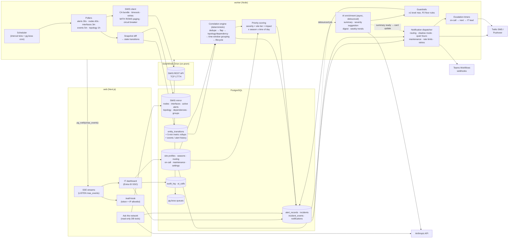
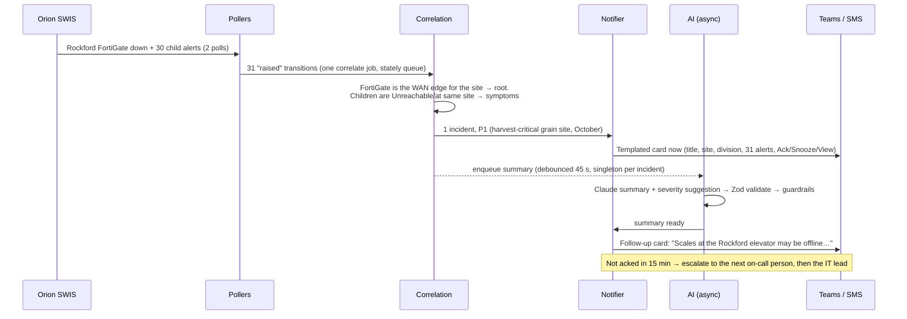

# MercerAlertService — Architecture

Status: design baseline (Milestone 0). Owner: Mercer Landmark IT.

## 1. What this is

SolarWinds Orion/NPM keeps doing all device polling. MercerAlertService (MAS) reads
Orion through the SWIS REST API, turns the raw alert stream into a few clear,
prioritized incidents, and delivers them to Teams, SMS and push. It also gives the
IT team a live dashboard and a NOC wall display.

Design rules. Every later decision follows from these:

1. **SWIS is the only device data source.** MAS never polls a device directly.
2. **Deterministic first.** Code decides whether an incident exists, how alerts group,
   and whether a notification goes out. AI only enriches the result: summaries,
   suggestions and digests.
3. **AI is never on the critical path.** If the Anthropic API is slow, down or over
   budget, incidents still form and templated notifications still go out. The AI
   summary is attached when it arrives.
4. **Store transitions, not polls.** We store current snapshots, state changes and
   5-minute metric rollups. We don't keep every poll result.
5. **Fail loud.** If SWIS, the worker, a notifier or the AI budget fails, MAS raises
   its own visible signal: an incident, a banner, or the wall's "DATA STALE" banner.
6. **Shadow mode first.** A single flag sends every outbound message to one test
   Teams channel, so MAS can run alongside the existing SolarWinds emails before cutover.

## 2. Components

| Service (Compose) | Process                        | Responsibilities                                                                                                                                                                 |
| ----------------- | ------------------------------ | -------------------------------------------------------------------------------------------------------------------------------------------------------------------------------- |
| `db`              | PostgreSQL 16                  | All state: SWIS mirror, transitions, incidents, config, audit, pg-boss queues (`pgboss` schema). Named volume `pgdata`.                                                          |
| `migrate`         | one-shot (worker image)        | Applies Drizzle SQL migrations, then exits. `web` and `worker` wait for it to complete.                                                                                          |
| `worker`          | Node (long-running)            | SWIS polling, correlation, scoring, AI calls, notifications, escalations, digests, retention, self-monitoring, heartbeat. Exposes `:9090/healthz` for the container healthcheck. |
| `web`             | Next.js (App Router)           | IT dashboard (Entra SSO), admin, "Ask the network" chat API, SSE streams, `/wall` kiosk, `/api/health`. **Does no polling.**                                                     |
| `backup`          | postgres:16-alpine + cron loop | Nightly `pg_dump -Fc` to the `backups` volume, with rotation.                                                                                                                    |
| `mock-swis`       | Node (dev/CI profile only)     | Fake SWIS that serves a synthetic Mercer-like world or recorded fixtures, with a control API for scenarios.                                                                      |

Monorepo packages (pnpm workspaces, TypeScript everywhere):

```
apps/web          Next.js UI + API routes + SSE
apps/worker       pg-boss job handlers, pollers, scheduler, health server
packages/core     domain types, config (zod env), logger, status/role/site mapping,
                  correlation + scoring + guardrails (pure, heavily unit-tested)
packages/db       Drizzle schema, migrations, repositories, seed data
packages/swis     SWIS client (TLS/CA, retries, circuit breaker, WITH ROWS paging),
                  SWQL query catalog, row schemas, schema probe, discovery
packages/notify   (M4) Notifier interface; Teams Workflows, Twilio, Pushover providers
packages/ai       (M5) Anthropic client wrapper, prompts, schemas, budget, redaction
tools/mock-swis   mock SWIS server + synthetic world generator
tools/simulator   (M2) scenario CLI that replays storms and asserts outcomes
scripts/          swis-discover.ts, swis-record.ts, dev helpers
```

## 3. Data flow



### Alert storm, end to end (target behavior)



## 4. Worker jobs

Pollers run on **interval ticks**, which support sub-minute periods such as 30 s, and
push into pg-boss queues that use the `stately` policy: at most one queued job and one
active job per queue. A slow SWIS therefore can never pile up overlapping polls, and
several worker replicas cannot double-poll. Wall-clock jobs use pg-boss cron with the
`America/New_York` time zone.

| Queue                             | Trigger                                                                | Policy    | Milestone                        |
| --------------------------------- | ---------------------------------------------------------------------- | --------- | -------------------------------- |
| `swis.poll.alerts`                | every 30 s                                                             | stately   | M1                               |
| `swis.poll.nodes`                 | every 60 s                                                             | stately   | M1                               |
| `swis.poll.interfaces`            | every 180 s                                                            | stately   | M1                               |
| `swis.poll.events`                | every 300 s                                                            | stately   | M1                               |
| `swis.poll.topology`              | every 3600 s, and at startup                                           | stately   | M1                               |
| `maint.retention`                 | cron `15 3 * * *` ET                                                   | singleton | M1                               |
| `correlate.run`                   | after any poll that produced transitions, plus every 30 s              | stately   | M2                               |
| `incident.lifecycle`              | every 30 s: hold-down auto-resolve, snooze expiry, maintenance windows | stately   | M2                               |
| `notify.dispatch` / `notify.send` | on incident open or material change; retries with backoff              | standard  | M4                               |
| `notify.escalate`                 | delayed job (`startAfter` = ack timeout)                               | standard  | M4                               |
| `ai.incident.summary`             | debounced per incident (`singletonKey`, 45 s)                          | standard  | M5                               |
| `ai.digest.daily`                 | cron `0 7 * * *` ET (configurable)                                     | singleton | M5                               |
| `ai.digest.weekly`                | cron `30 7 * * 1` ET                                                   | singleton | M5                               |
| `maint.selfcheck`                 | every 60 s: queue backlog, notifier health, SWIS errors                | stately   | M1 (heartbeat), M4 (self-alerts) |

## 5. SWIS integration

- Endpoint `https://<orion>:17774/SolarWinds/InformationService/v3/Json/Query`, using
  POST `{query, parameters}` and Basic auth with a dedicated **read-only** Orion account.
  Parameters are always bound (`@name`). We never interpolate strings. The only inlined
  values are validated integers in `WITH ROWS a TO b` and identifiers checked against
  `^[A-Za-z_][A-Za-z0-9_]*$` (custom property names).
- **TLS:** `SWIS_CA_CERT_PATH` points to a PEM bundle, which is how Orion's self-signed
  certificate is trusted. `SWIS_TLS_SERVERNAME` can override SNI and hostname
  verification, for example when connecting by IP to a certificate issued for the FQDN.
  `SWIS_TLS_INSECURE_SKIP_VERIFY_DEV_ONLY=true` turns verification off. It logs at
  **error** level at startup and every 10 minutes, shows on `/api/health`, and is meant
  for development only.
- **Resilience:** per-request timeout (default 20 s). Up to 3 retries with exponential
  backoff and jitter on network errors, 408, 429 and 5xx. No retry on 400 (a SWQL
  error) or 401/403. A circuit breaker opens after 5 consecutive failures and moves to
  half-open after 30 s. While it is open, polls are recorded as `skipped_circuit_open`.
- **Paging:** `ORDER BY <key> WITH ROWS n TO m` (default page 1000) for snapshot
  queries. Event and alert-history queries are incremental: `WHERE ID > @cursor`, with
  `WITH ROWS 1 TO n` as the page limit.
- **Schema probe:** at startup and hourly, the worker reads `Metadata.Property` for every
  entity we query. Optional fields that are missing in this Orion version are dropped
  from the SELECT with a warning. A missing required field fails that poller with a clear
  error. Custom-property columns are discovered from `Metadata.Property` on
  `Orion.NodesCustomProperties`.
- **Monitoring source down:** if the breaker opens, or the last successful alert poll is
  older than `SWIS_STALE_AFTER_SEC` (default 120 s), the worker writes a `source down`
  transition. The correlation engine (M2) turns that into a fixed **P1 "Monitoring source
  down"** incident. Notifications don't depend on SWIS, so this incident still goes out.
- **Write-back (off by default):** when `SWIS_WRITEBACK_ENABLED=true` and the separate
  `SWIS_WRITE_USERNAME`/`SWIS_WRITE_PASSWORD` account is configured, acknowledging an
  incident in MAS invokes `Orion.AlertActive.Acknowledge` for the member alerts'
  AlertObjectIDs. The read-only client never gets these credentials.

The full query list is in [swql-queries.md](swql-queries.md).

## 6. Storage model

Three layers. Full schema: [schema.md](schema.md).

1. **Mirror (current state):** `orion_nodes`, `orion_interfaces`, `orion_active_alerts`,
   topology, dependencies and groups. These are upserted from each successful **complete**
   fetch. A failed or partial fetch never deletes rows and never "clears" alerts.
2. **History:** `entity_transitions` (alert raised, cleared, retriggered or acked; node and
   interface status changes; source up/down). There are also 5-minute rollups
   (`node_metrics_5m`, `interface_metrics_5m`, upserted with running avg and max) and the
   Orion `events` and `alert_history` streams. Retention is 90 days by default.
3. **Derived:** `alert_records` (deduped per alert rule + entity), `incidents`,
   `incident_members` and `incident_events`, plus notifications, digests and AI call logs.
   Incidents are kept for 2 years.

All timestamps are `timestamptz` stored in UTC. Business logic (business hours, harvest
season, digests) runs in `APP_TIMEZONE`, default `America/New_York`.

## 7. Correlation & priority (M2/M3 design summary)

The pipeline runs over unprocessed transitions plus current mirror state:

1. **Dedupe.** The key is `(AlertID, EntityUri)`. A re-trigger increments
   `trigger_count` and updates `last_seen_at` on the same `alert_record`.
2. **Flap detection.** If an entity has ≥ N state changes in M minutes (defaults 4 in 20),
   it becomes, or joins, a single `flapping` incident. Its member alerts don't open
   separate incidents.
3. **Topology and dependency root cause.** If a node is down and it is the site's WAN
   edge (role `firewall`) or an upstream parent, it becomes the root. The evidence comes,
   in order, from Orion `Dependencies` (groups are expanded to members),
   `TopologyConnections`, and Orion's own `Unreachable` (status 12) children. Downstream
   nodes and interfaces become **symptoms** of that root incident. If none of that
   evidence exists, we fall back to grouping by site.
4. **Time-window grouping.** Alerts at the same site within `CORRELATION_WINDOW_SEC`
   (default 180 s) join the open incident for that site.
5. **Lifecycle.** `open → acknowledged → resolved → closed`. Resolution is automatic once
   all member alerts have cleared for `RESOLVE_HOLDDOWN_SEC` (default 300 s). An incident
   reopens if a member re-raises within the hold-down period or within
   `REOPEN_WINDOW_SEC`. Snooze applies per incident. Maintenance windows apply per site or
   node and suppress notifications, and optionally incident creation.
6. **Noise ratio.** For any time window, `raw alert raises ÷ incidents opened`. It is
   computed from `entity_transitions` and `incidents` and shown on the dashboard. This is
   the main success metric.

**Priority** comes from a deterministic score. Every factor is stored in
`incidents.priority_factors`, so the UI can explain it.

```
base   = impact points + Orion severity points
         impact: site_outage 50 · core_device 35 · multi_device 25 · single_device 15
                 · interface 10 · informational 5
         severity: Critical 20 · Serious 15 · Warning 8 · Notice 3 · Informational 0
score  = base × tier (Critical 1.4 · High 1.2 · Standard 1.0)
              × season (harvest ∧ harvest-critical site 1.5 · harvest ∧ grain division 1.2
                        · custom high-risk period: per-period multiplier)
              × time (outside site business hours 0.8, never applied to site outages or
                      firewall-down at harvest-critical sites during harvest)
P1 ≥ 70 · P2 ≥ 50 · P3 ≥ 30 · else P4        (weights and thresholds are editable in Admin)
```

Worked examples. A harvest-critical, Critical-tier grain elevator whose FortiGate is down
in October scores (50+20)×1.4×1.5 = 147, which is **P1**. A Standard-tier grain site down
after hours in March scores 70×0.8 = 56, which is **P2**. A single AP warning scores
23, which is **P4**. The same AP at a harvest-critical site during harvest scores 34.5,
which is **P3**.

The **recovery target** is shown on each incident and drives escalation urgency. It is
4 h for harvest-critical sites during harvest and 8 h otherwise.

**AI severity guardrail.** Claude can propose ±1 level, with a reason that is stored and
displayed. The final priority is clamped. AI can never lower a whole-site outage, a
firewall-down alert, or any harvest-critical site during harvest below **P2**, and the
code enforces this after the model responds. "Monitoring source down" is always P1.

## 8. AI layer (M5 design summary)

| Task                                 | Default model                         | Effort | Notes                                                       |
| ------------------------------------ | ------------------------------------- | ------ | ----------------------------------------------------------- |
| Severity suggestion / classification | `claude-haiku-5-5` (`AI_MODEL_FAST`)  | low    | Output shape: `{adjust: -1\|0\|1, reason}`, then guardrails |
| Incident summary                     | `claude-opus-5-5` (`AI_MODEL_STRONG`) | medium | On open and on material change, debounced                   |
| Daily / weekly digests               | `claude-opus-5-5`                     | medium | 07:00 ET daily, Monday weekly                               |
| Ask the network (chat)               | `claude-opus-5-5`                     | medium | Read-only tools that query the DB, never SQL, never SWIS    |

Each task's model can be overridden with `AI_MODEL_<TASK>`.

- **Structured output.** We use `client.messages.parse()` with `zodOutputFormat(schema)`,
  which gives JSON-schema-constrained output, and we re-validate with Zod. The current
  Opus and Sonnet models reject _forced_ `tool_choice`, so JSON-schema structured outputs
  is the supported way to get the "tool use with a JSON schema" guarantee. The chat uses
  real tools with `strict: true`. If the response is invalid, we retry once and then fall
  back to the templated summary.
- **Refusals and errors.** We check `stop_reason` before reading content. Opus calls
  enable server-side fallbacks (`fallbacks: "default"`). Any refusal, timeout or API
  error falls back to the template and is logged.
- **Prompt caching.** The environment description and site profiles (serialized as
  sorted JSON) form a stable system prefix with `cache_control`. Volatile incident data
  comes after the breakpoint.
- **Budget.** `ai_calls` logs purpose, model, tokens (including cache read/write),
  latency and estimated cost. `AI_DAILY_BUDGET_USD` shows a warning banner at 80%. At
  100%, summaries, digests and chat drop to templates or are disabled until midnight ET.
- **Debounce.** At most one summary job is queued per incident. A storm of 40 alerts
  produces one summary, and later updates fire only on _material_ change: priority, root
  cause, affected sites, or resolved.
- **Redaction.** When `AI_REDACT=true` (default), IPv4/IPv6, MAC and serial-like tokens
  are replaced with stable placeholders (`[IP-3]`) before the call and restored locally
  for display. Hostnames and site names are sent.

## 9. Notifications (M4 design summary)

- The `Notifier` interface has `send(message) → {providerRef, threadRef?}` and
  `update(threadRef, message)`. The Teams Workflows provider posts Adaptive Cards
  (priority color, title, site and division, summary, alert count, duration, and
  `Action.OpenUrl` for Ack, Snooze and View). A Workflows webhook doesn't return a
  message ID, so updates are posted as follow-up cards tagged `INC-1234 · Update n`. The
  README also includes an optional flow design that returns the message ID, which lets
  the flow reply in-thread. A phase-2 Teams bot (`Action.Execute`) plugs into the same
  interface.
- SMS goes through Twilio, and push through Pushover. Defaults: P1 always, and P2
  outside business hours. Messages go to the current on-call person (weekly rotation
  table) and are under 300 characters, with a short link (`/i/<code>`). If an incident is
  not acked in 15 min, it escalates to the next person, then to the IT lead.
- Every attempt is recorded in `notifications`, with retries and backoff. If a provider
  fails repeatedly, a dashboard banner appears and an internal self-alert is posted to
  the other channel.
- Quiet hours, maintenance windows and **shadow mode** apply to all channels. In shadow
  mode, every message is redirected to `TEAMS_SHADOW_WEBHOOK` and labeled `[SHADOW]`, and
  no SMS or push is sent unless `SHADOW_ALLOW_SMS=true`.

## 10. Web, live updates and the wall

- **Auth.** Auth.js with the Microsoft Entra ID provider. Sign-in is allowed only if the
  token's `groups` claim contains `ENTRA_ALLOWED_GROUP_ID`. We recommend setting the app
  registration to emit "groups assigned to the application" and turning on "assignment
  required" in Entra, which avoids group overage. `is_admin` comes from
  `ENTRA_ADMIN_GROUP_ID` or `BOOTSTRAP_ADMIN_EMAILS`.
- **SSE.** Each web process holds one `LISTEN mas_events` connection and fans out to SSE
  clients. The worker sends small `pg_notify` payloads, for example
  `{t:"incident", id}` or `{t:"poll", poller}`, and clients refetch what changed. A
  heartbeat comment goes out every 15 s.
- **Wall `/wall/<token>`.** No SSO. The token is 256-bit random, stored as SHA-256, and
  can be revoked or rotated, with a per-token CIDR allowlist. `X-Forwarded-For` is only
  trusted when `TRUST_PROXY=true`. The wall is read-only, high-contrast and dark, and
  rotates between the site grid, the map and active incidents. It shows only the AI title
  and short summary. A "DATA STALE" banner appears when the worker heartbeat or the last
  SWIS poll is older than its threshold.
- **Map.** Leaflet with an OSM raster tile layer (`MAP_TILE_URL`). Set
  `MAP_MODE=image` to use an offline image with `CRS.Simple` and per-site pixel
  coordinates.

## 11. Security & operations

- Secrets come only from environment variables or Docker secrets. Every secret `X` also
  accepts `X_FILE`. We ship `.env.example` and never commit real values. Teams webhook
  URLs are secrets: admin routing rules reference channels by key (`TEAMS_WEBHOOK_<KEY>`),
  never by URL.
- An `audit_log` row is written for every UI mutation, every kiosk token change, and
  every write-back to Orion.
- **Self-monitoring.** The worker heartbeat is written every 15 s. `/api/health` returns
  503 when the DB is unreachable or the heartbeat is older than 60 s. A worker can't
  report its own death, so we use Docker restart policies, the dashboard banner and wall
  stale banner, and optionally an Orion SAM HTTP monitor on `/api/health`. SolarWinds
  watching the watcher closes the loop. `DEADMAN_PING_URL` is also available.
- Logs are structured JSON (pino), with redaction of `authorization`, passwords and
  webhook URLs.
- **Outbound hosts the VM needs:** Orion `:17774`, `api.anthropic.com`, the Teams Workflows
  host (`*.logic.azure.com` / `*.powerplatform.com`), `api.twilio.com`, `api.pushover.net`,
  and OSM tiles unless `MAP_MODE=image`.

## 12. Key decisions

| Decision                                        | Why                                                                                                                                                                                                                                                                                                        |
| ----------------------------------------------- | ---------------------------------------------------------------------------------------------------------------------------------------------------------------------------------------------------------------------------------------------------------------------------------------------------------- |
| **Drizzle** over Prisma                         | SQL-first schema in TypeScript, shared by `web` and `worker`, with no query-engine binary, which keeps Docker images small. Migrations are plain, reviewable SQL. Time-series and `ON CONFLICT` upserts with running aggregates are easy to write. It also fits pg-boss, which lives in the same Postgres. |
| **pg-boss** (no Redis)                          | It is already in Postgres. `stately` queues give non-overlapping polls, `singletonKey` debounces AI jobs, delayed jobs handle escalation, and cron with a time zone runs digests. One fewer service to run.                                                                                                |
| Interval ticks + stately queues for polls       | pg-boss cron is minute-granular, but alerts need 30 s. Ticks enqueue, and the stately policy deduplicates across replicas.                                                                                                                                                                                 |
| SSE over LISTEN/NOTIFY                          | Real-time without extra infrastructure. Payloads stay small, and clients refetch over normal authenticated routes.                                                                                                                                                                                         |
| Structured outputs instead of forced tool calls | Current Claude models reject forced `tool_choice`. JSON-schema output plus Zod gives the same guarantee.                                                                                                                                                                                                   |
| **Node 22+** (images use Node 24 LTS)           | Node 20 reached end of life in April 2026. pg-boss 12 and undici 8 require Node ≥ 22.                                                                                                                                                                                                                      |
| TypeScript 5.9 (pinned)                         | TS 7 (the native compiler) isn't supported yet by typescript-eslint or Next tooling.                                                                                                                                                                                                                       |
| Leaflet over MapLibre                           | We only need raster OSM and an offline image overlay (`CRS.Simple`). It is lighter and simpler.                                                                                                                                                                                                            |
