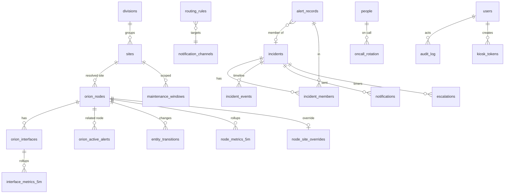

# Database schema

PostgreSQL 16, managed by Drizzle ORM. The source of truth is
`packages/db/src/schema/*.ts`. Migrations live in `packages/db/migrations` (generated
with `pnpm db:generate`, applied with `pnpm db:migrate` or by the `migrate` Compose
service). This document describes the full target schema. The **M** column shows the
milestone that introduces each table.

Conventions:

* All times are `timestamptz` in UTC.
* Orion IDs keep their Orion names and types, for example `node_id int` and
  `alert_active_id bigint`.
* Enums are Postgres enums when they are closed sets, and `text` when admins may extend
  them.
* Every table has `created_at` and, if mutable, `updated_at`. They are omitted below
  unless they matter.
* pg-boss owns the separate `pgboss` schema.

## Relationships (core)

## 1. Reference & configuration

| Table | M | Key columns | Notes |
|---|---|---|---|
| `divisions` | 1 | `code text PK`, `name`, `is_affiliate bool`, `aliases text[]`, `sort_order` | Seeded: corporate, grain, agronomy, feed, energy, mps_feed (affiliate), heartland_feed (affiliate). `aliases` match Orion custom-property values case-insensitively. |
| `sites` | 1 | `id serial PK`, `code text UNIQUE`, `name`, `division_code → divisions`, `city`, `state`, `lat`, `lon`, `map_x`, `map_y`, `tier enum(critical,high,standard)`, `harvest_critical bool`, `business_hours jsonb`, `harvest_hours jsonb?`, `owner_group`, `contact_notes`, `aliases text[]`, `profile_status enum(placeholder,auto,confirmed)` | This is the Site Profile. `business_hours` = `{days:[1..7], start:"07:00", end:"17:00"}` in `APP_TIMEZONE`. Sites first seen in a custom property are auto-created with `profile_status='auto'`. |
| `node_site_overrides` | 1 | `node_id int PK`, `site_id?`, `division_code?`, `device_role?`, `reason`, `updated_by → users`, `updated_at` | Admin overrides, applied before custom properties. |
| `app_settings` | 1 | `key text PK`, `value jsonb`, `updated_by`, `updated_at` | Keys: `mapping` (custom-property names and caption/role regex rules), `scoring`, `correlation`, `notify`, `ai`. Env vars provide defaults, and rows override them. |
| `season_periods` | 2 | `id`, `name`, `kind enum(harvest,high_risk)`, `start_md 'MM-DD'`, `end_md 'MM-DD'`, `year int?` (null = recurring), `multiplier real`, `divisions text[]?`, `harvest_critical_only bool`, `enabled` | Seeded: Harvest 09-01 → 12-15. Disabled suggestions: wheat harvest and spring agronomy (see open questions). |
| `maintenance_windows` | 2 | `id`, `scope enum(global,site,node)`, `site_id?`, `node_id?`, `starts_at`, `ends_at`, `rrule text?`, `suppress enum(notifications,incidents)`, `reason`, `created_by` | `rrule` allows recurring windows, for example the Sunday 02:00 firmware window. |

## 2. SWIS mirror (current state)

The mirror is upserted only from a complete, successful fetch. Rows that are missing
from such a fetch get `removed_at` (nodes and interfaces) or are deleted (active alerts,
which also produces a `cleared` transition).

| Table | M | Key columns |
|---|---|---|
| `orion_nodes` | 1 | `node_id int PK`, `caption`, `dns`, `sys_name`, `ip_address`, `vendor`, `machine_type`, `status smallint`, `status_norm`, `status_description`, `response_time_ms`, `percent_loss`, `cpu_load`, `percent_memory_used`, `last_boot`, `unmanaged`, `object_sub_type`, `location`, `is_server`, `uri`, `custom_properties jsonb`, `site_id?`, `division_code?`, `device_role`, `first_seen_at`, `last_polled_at`, `last_status_change_at`, `removed_at?` |
| `orion_interfaces` | 1 | `interface_id int PK`, `node_id`, `name`, `caption`, `full_name`, `alias`, `type_description`, `status`, `status_norm`, `oper_status`, `admin_status`, `in_percent_util`, `out_percent_util`, `in_bps`, `out_bps`, `speed_bps`, `in_errors_hour`, `out_errors_hour`, `in_discards_hour`, `out_discards_hour`, `unmanaged`, `uri`, `first_seen_at`, `last_polled_at`, `last_status_change_at`, `removed_at?` |
| `orion_alert_configs` | 1 | `alert_id int PK`, `alert_ref_id`, `name`, `description`, `enabled`, `severity smallint`, `object_type`, `synced_at` |
| `orion_active_alerts` | 1 | `alert_active_id bigint PK`, `alert_object_id`, `alert_id`, `alert_name`, `severity`, `triggered_at`, `message`, `acknowledged`, `acknowledged_by`, `acknowledged_at`, `entity_uri`, `entity_type`, `entity_caption`, `related_node_id`, `related_node_caption`, `node_id` (resolved), `interface_id` (parsed from URI), `site_id` (resolved), `trigger_count`, `first_seen_at`, `last_seen_at` |
| `topology_connections` | 1 | `id`, `src_node_id`, `src_interface_id`, `dest_node_id`, `dest_interface_id`, `layer_type`, `synced_at`. UNIQUE on (src, src_if, dest, dest_if, layer) |
| `orion_dependencies` | 1 | `dependency_id int PK`, `name`, `parent_uri`, `child_uri`, `parent_entity_type`, `child_entity_type`, `parent_node_id?`, `child_node_id?`, `parent_container_id?`, `child_container_id?`, `auto_managed`, `synced_at` |
| `orion_groups` | 1 | `container_id int PK`, `name`, `status`, `description`, `uri`, `synced_at` |
| `orion_group_members` | 1 | PK `(container_id, member_uri)`, `member_entity_type`, `member_primary_id`, `name`, `status`, `node_id?`, `synced_at` |

## 3. History

| Table | M | Key columns | Retention |
|---|---|---|---|
| `entity_transitions` | 1 | `id bigserial PK`, `kind enum(alert,node,interface,source)`, `change text`, `entity_key`, `node_id?`, `interface_id?`, `site_id?`, `alert_object_id?`, `alert_active_id?`, `from_state?`, `to_state`, `observed_at`, `source_at?`, `details jsonb`, `correlated_at?` | 90 d |
| `node_metrics_5m` | 1 | PK `(node_id, bucket)`, `samples`, `rt_avg`, `rt_max`, `loss_avg`, `loss_max`, `cpu_avg`, `cpu_max`, `mem_avg`, `mem_max` | 90 d |
| `interface_metrics_5m` | 1 | PK `(interface_id, bucket)`, `samples`, `in_util_avg`, `in_util_max`, `out_util_avg`, `out_util_max`, `in_bps_avg`, `out_bps_avg`, `in_errors`, `out_errors`, `in_discards`, `out_discards` | 90 d |
| `orion_events` | 1 | `event_id bigint PK`, `event_time`, `event_type`, `event_type_name`, `message`, `node_id?`, `net_object_id?`, `net_object_type?`, `acknowledged`, `ingested_at` | 90 d |
| `orion_alert_history` | 1 | `alert_history_id bigint PK`, `event_type`, `message`, `at`, `account_id`, `alert_active_id?`, `alert_object_id?`, `alert_id?`, `entity_uri?`, `related_node_id?`, `ingested_at` | 90 d |

`change` values:

* alert: `raised`, `retriggered`, `cleared`, `acked`, `unacked`
* node and interface: `status`
* source: `down`, `up`

`details.initialSync=true` marks alerts that were already active when MAS first saw them.

Indexes:

* `entity_transitions (correlated_at) WHERE correlated_at IS NULL`
* `entity_transitions (node_id, observed_at)`
* `entity_transitions (kind, entity_key, observed_at)`
* `orion_events (node_id, event_time)`

Metric rollups are upserted with running aggregates:
`avg = (avg*samples + x)/(samples+1)` and `max = greatest(max, x)`.

## 4. Operations

| Table | M | Key columns | Notes |
|---|---|---|---|
| `poller_state` | 1 | `poller text PK`, `last_started_at`, `last_success_at`, `last_error_at`, `last_error`, `consecutive_failures`, `last_duration_ms`, `last_row_count`, `cursor jsonb` | Drives the "last poll" tiles and the stale banners. `cursor` holds the event and alert-history watermarks. |
| `poll_runs` | 1 | `id bigserial`, `poller`, `started_at`, `finished_at`, `status enum(ok,error,skipped)`, `row_count`, `transition_count`, `duration_ms`, `error` | 30 d |
| `component_heartbeats` | 1 | `component text PK` (`worker`, `swis`), `last_beat_at`, `status`, `details jsonb`, `version`, `host` | |

## 5. Correlation & incidents

| Table | M | Key columns |
|---|---|---|
| `alert_records` | 2 | `id bigserial PK`, `dedupe_key UNIQUE` (`alertId:entityUri`), `alert_id`, `alert_name`, `entity_uri`, `entity_type`, `entity_caption`, `node_id?`, `interface_id?`, `site_id?`, `severity`, `state enum(active,cleared)`, `first_seen_at`, `last_seen_at`, `last_raised_at`, `cleared_at?`, `trigger_count`, `current_alert_active_id?`, `current_alert_object_id?`, `last_message`, `incident_id?` |
| `incidents` | 2 | `id bigserial PK` (shown as `INC-<id>`), `status enum(open,acknowledged,resolved,closed)`, `kind enum(site_outage,device_down,flapping,interface,ups_power,service,monitoring_source_down,generic)`, `title`, `template_summary`, `ai_title?`, `ai_summary jsonb?`, `ai_summary_at?`, `ai_summary_rev`, `priority enum(P1..P4)`, `base_priority`, `base_score real`, `priority_factors jsonb`, `ai_priority_adjust smallint?`, `ai_priority_reason?`, `guardrail_note?`, `primary_site_id?`, `division_code?`, `affected_site_ids int[]`, `root_node_id?`, `root_entity_uri?`, `correlation_key`, `recovery_target_min`, `opened_at`, `last_activity_at`, `acknowledged_at?`, `acknowledged_by?`, `resolve_pending_since?`, `resolved_at?`, `resolved_by?`, `closed_at?`, `snoozed_until?`, `snoozed_by?`, `alert_count`, `member_count`, `material_rev`, `in_maintenance bool` |
| `incident_members` | 2 | PK `(incident_id, alert_record_id)`, `role enum(root,symptom,member)`, `added_at`, `cleared_at?` |
| `incident_events` | 2 | `id bigserial`, `incident_id`, `at`, `type` (`opened`, `member_added`, `priority_changed`, `status_changed`, `acked`, `snoozed`, `note`, `ai_summary`, `notified`, `escalated`, `reopened`, `resolved`, `closed`), `actor` (`user:<id>` / `system` / `ai`), `message`, `details jsonb` |

Indexes:

* `incidents (status) WHERE status IN ('open','acknowledged')`
* `incidents (primary_site_id, status)`
* `incidents (opened_at)`
* `alert_records (incident_id)`
* `alert_records (node_id, state)`

## 6. Notifications & on-call

| Table | M | Key columns |
|---|---|---|
| `notification_channels` | 4 | `key text PK`, `kind enum(teams,sms,pushover)`, `display_name`, `secret_env` (name of the env var holding the webhook URL), `enabled`, `consecutive_failures`, `last_failure_at`, `health enum(ok,degraded,failing)` |
| `routing_rules` | 4 | `id`, `name`, `position`, `enabled`, `match jsonb` (`divisions[]`, `priorities[]`, `kinds[]`, `site_ids[]`, `hours: in\|out\|any`), `channel_key`, `page_oncall bool`, `escalate_after_min`, `stop bool` |
| `people` | 4 | `id`, `name`, `email`, `phone_e164`, `pushover_user_key`, `page_via enum(sms,pushover,both)`, `is_it_lead`, `active` |
| `oncall_rotation` | 4 | `id`, `week_start date UNIQUE`, `primary_person_id`, `secondary_person_id` (one row per week, and the handoff time is configurable) |
| `oncall_overrides` | 4 | `id`, `person_id`, `starts_at`, `ends_at`, `reason` |
| `notifications` | 4 | `id bigserial`, `incident_id?`, `purpose enum(incident_open,incident_update,incident_resolved,escalation,digest,self_alert,test)`, `channel_kind`, `channel_key?`, `recipient`, `payload jsonb`, `status enum(queued,sent,failed,suppressed,shadowed,rate_limited)`, `suppress_reason?`, `attempts`, `last_error?`, `provider_ref?`, `thread_ref?`, `created_at`, `sent_at?`, `next_attempt_at?` |
| `escalations` | 4 | `id`, `incident_id`, `level smallint`, `person_id`, `due_at`, `fired_at?`, `cancelled_at?`, `job_id` |
| `short_links` | 4 | `code text PK`, `incident_id`, `expires_at` |

## 7. AI

| Table | M | Key columns |
|---|---|---|
| `ai_calls` | 5 | `id bigserial`, `at`, `purpose`, `model`, `incident_id?`, `input_tokens`, `output_tokens`, `cache_read_tokens`, `cache_write_tokens`, `latency_ms`, `cost_usd numeric(10,5)`, `status enum(ok,retried,fallback,error,refused,budget_blocked)`, `error?`, `redacted bool` |
| `digests` | 5 | `id`, `kind enum(daily,weekly)`, `period_start`, `period_end`, `source enum(ai,template)`, `content jsonb`, `markdown`, `ai_call_id?`, `notification_id?` |
| `chat_threads` / `chat_messages` | 6 | thread: `id`, `user_id`, `title`. Message: `id`, `thread_id`, `role`, `content jsonb`, `citations jsonb`, `ai_call_id?` |

## 8. Auth & audit

| Table | M | Key columns |
|---|---|---|
| `users` | 3 | `id serial`, `entra_oid UNIQUE`, `email`, `name`, `is_admin`, `last_login_at` |
| `kiosk_tokens` | 3 | `id`, `name`, `token_hash bytea UNIQUE` (SHA-256), `token_prefix` (first 6 characters, for display only), `allowed_cidrs text[]`, `created_by`, `expires_at?`, `revoked_at?`, `last_used_at?`, `last_used_ip?` |
| `audit_log` | 1 | `id bigserial`, `at`, `actor_type enum(user,kiosk,system)`, `actor_id?`, `actor_label`, `action`, `target_type`, `target_id`, `before jsonb?`, `after jsonb?`, `ip?`, `user_agent?` |

## 9. Retention (`maint.retention`, nightly)

| Data | Default | Env |
|---|---|---|
| Transitions, metric rollups, Orion events, alert history | 90 days | `RETENTION_RAW_DAYS` |
| `poll_runs` | 30 days | `RETENTION_POLL_RUNS_DAYS` |
| Incidents (and cascaded members and events), notifications, digests, AI calls | 2 years | `RETENTION_INCIDENT_DAYS` (730) |
| `audit_log` | 2 years | `RETENTION_AUDIT_DAYS` (730) |
