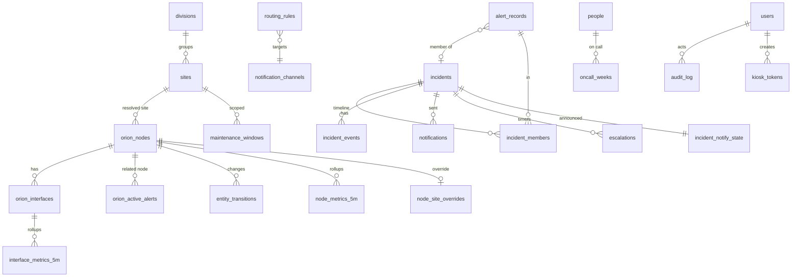

# Database schema

PostgreSQL 16, managed by Drizzle ORM. The source of truth is
`packages/db/src/schema/*.ts`. Migrations live in `packages/db/migrations` (generated
with `pnpm db:generate`, applied with `pnpm db:migrate` or by the `migrate` Compose
service). This document describes the full target schema. The **M** column shows the
milestone that introduces each table.

Conventions:

- All times are `timestamptz` in UTC.
- Orion IDs keep their Orion names and types, for example `node_id int` and
  `alert_active_id bigint`.
- Enums are Postgres enums when they are closed sets, and `text` when admins may extend
  them.
- Every table has `created_at` and, if mutable, `updated_at`. They are omitted below
  unless they matter.
- pg-boss owns the separate `pgboss` schema.

## Relationships (core)

## 1. Reference & configuration

| Table                  | M   | Key columns                                                                                                                                                                                                                                                                                                                                                                   | Notes                                                                                                                                                                                                                                                                                                                                                                                                                                        |
| ---------------------- | --- | ----------------------------------------------------------------------------------------------------------------------------------------------------------------------------------------------------------------------------------------------------------------------------------------------------------------------------------------------------------------------------- | -------------------------------------------------------------------------------------------------------------------------------------------------------------------------------------------------------------------------------------------------------------------------------------------------------------------------------------------------------------------------------------------------------------------------------------------- |
| `divisions`            | 1   | `code text PK`, `name`, `is_affiliate bool`, `aliases text[]`, `sort_order`                                                                                                                                                                                                                                                                                                   | Seeded: corporate, grain, agronomy, feed, energy, mps_feed (affiliate), heartland_feed (affiliate). `aliases` match Orion custom-property values case-insensitively.                                                                                                                                                                                                                                                                         |
| `sites`                | 1   | `id serial PK`, `code text UNIQUE`, `name`, `division_code → divisions`, `city`, `state`, `lat`, `lon`, `map_x`, `map_y`, `tier enum(critical,high,standard)`, `harvest_critical bool`, `business_hours jsonb`, `harvest_hours jsonb?`, `owner_group`, `contact_notes`, `aliases text[]`, `profile_status enum(placeholder,auto,confirmed)`, `orion_container_id int UNIQUE?` | This is the Site Profile. `orion_container_id` links it to its SolarWinds site group (found automatically, or by `SITE_GROUP_PARENT` / `_PATTERN`): the name follows the group and the notes are the group description; `contact_notes` is for sites without a group. `business_hours` = `{days:[1..7], start:"07:00", end:"17:00"}` in `APP_TIMEZONE`. Sites first seen in a custom property are auto-created with `profile_status='auto'`. |
| `node_site_overrides`  | 1   | `node_id int PK`, `site_id?`, `division_code?`, `device_role?`, `reason`, `updated_by → users`, `updated_at`                                                                                                                                                                                                                                                                  | Admin overrides, applied before custom properties.                                                                                                                                                                                                                                                                                                                                                                                           |
| `site_group_decisions` | ✓   | `container_id int PK`, `decision enum(site,not_site)`, `group_name`, `decided_by`, `decided_at`                                                                                                                                                                                                                                                                               | An admin's choice for one SolarWinds group from Settings → Mapping; overrides automatic and manual site-group selection. Audited as `site.group_decision`.                                                                                                                                                                                                                                                                                   |
| `site_notes_writes`    | ✓   | `id bigserial PK`, `site_id → sites` (cascade), `container_id`, `text`, `base?` (the description the editor started from), `requested_by`, `status enum(pending,ok,conflict,failed,skipped)`, `error?`, `created_at`, `completed_at?`                                                                                                                                         | Site-notes edits written to the SolarWinds group description by `swis.writeback.site-notes`; the newest row per site is shown next to the notes.                                                                                                                                                                                                                                                                                             |
| `app_settings`         | 1   | `key text PK`, `value jsonb`, `updated_by`, `updated_at`                                                                                                                                                                                                                                                                                                                      | Settings saved from the web UI, keyed by the env var name (`SWIS_HOST`, …). The value is `{"v": "…"}`, or `{"enc": "v1:…"}` for secrets (AES-256-GCM under the master key). `internal.*` keys hold the setup code (encrypted), the last discovery report and the last connection test. `MAS_SETUP_COMPLETE` starts polling. Environment variables override.                                                                                  |
| `season_periods`       | 2   | `id`, `name`, `kind enum(harvest,high_risk)`, `start_md 'MM-DD'`, `end_md 'MM-DD'`, `year int?` (null = recurring), `multiplier real`, `divisions text[]?`, `harvest_critical_only bool`, `enabled`                                                                                                                                                                           | Seeded: Harvest 09-01 → 12-15. Disabled suggestions: wheat harvest (grain) and spring application season (agronomy). Seeded only on a fresh install. Editable in Settings → Seasons.                                                                                                                                                                                                                                                         |
| `maintenance_windows`  | 2   | `id`, `scope enum(global,site,node)`, `site_id?`, `node_id?`, `starts_at`, `ends_at?`, `recurrence jsonb?` (`{weekdays, start, durationMin}` in APP_TIMEZONE), `suppress enum(notifications,incidents)`, `reason`, `created_by`                                                                                                                                               | Weekly recurrence covers the Sunday 02:00 firmware window. Editable in Settings → Maintenance.                                                                                                                                                                                                                                                                                                                                               |

## 2. SWIS mirror (current state)

The mirror is upserted only from a complete, successful fetch. Rows that are missing
from such a fetch get `removed_at` (nodes and interfaces) or are deleted (active alerts,
which also produces a `cleared` transition).

| Table                  | M   | Key columns                                                                                                                                                                                                                                                                                                                                                                                                                                                                                                                                     |
| ---------------------- | --- | ----------------------------------------------------------------------------------------------------------------------------------------------------------------------------------------------------------------------------------------------------------------------------------------------------------------------------------------------------------------------------------------------------------------------------------------------------------------------------------------------------------------------------------------------- |
| `orion_nodes`          | 1   | `node_id int PK`, `caption`, `dns`, `sys_name`, `ip_address`, `vendor`, `machine_type`, `status smallint`, `status_norm`, `status_description`, `response_time_ms`, `percent_loss`, `cpu_load`, `percent_memory_used`, `last_boot`, `unmanaged`, `object_sub_type`, `location`, `is_server`, `uri`, `custom_properties jsonb` (all node custom properties), `site_id?`, `division_code?`, `site_source` (override / custom_property / caption / none), `device_role`, `first_seen_at`, `last_polled_at`, `last_status_change_at`, `removed_at?` |
| `orion_interfaces`     | 1   | `interface_id int PK`, `node_id`, `name`, `caption`, `full_name`, `alias`, `type_description`, `status`, `status_norm`, `oper_status`, `admin_status`, `in_percent_util`, `out_percent_util`, `in_bps`, `out_bps`, `speed_bps`, `in_errors_hour`, `out_errors_hour`, `in_discards_hour`, `out_discards_hour`, `unmanaged`, `uri`, `first_seen_at`, `last_polled_at`, `last_status_change_at`, `removed_at?`                                                                                                                                     |
| `orion_alert_configs`  | 1   | `alert_id int PK`, `alert_ref_id`, `name`, `description`, `enabled`, `severity smallint`, `object_type`, `synced_at`                                                                                                                                                                                                                                                                                                                                                                                                                            |
| `orion_active_alerts`  | 1   | `alert_active_id bigint PK`, `alert_object_id`, `alert_id`, `alert_name`, `severity`, `triggered_at`, `message`, `acknowledged`, `acknowledged_by`, `acknowledged_at`, `entity_uri`, `entity_type`, `entity_caption`, `related_node_id`, `related_node_caption`, `node_id` (resolved), `interface_id` (parsed from URI), `site_id` (resolved), `trigger_count`, `first_seen_at`, `last_seen_at`                                                                                                                                                 |
| `topology_connections` | 1   | `id`, `src_node_id`, `src_interface_id`, `dest_node_id`, `dest_interface_id`, `layer_type`, `synced_at`. UNIQUE on (src, src_if, dest, dest_if, layer)                                                                                                                                                                                                                                                                                                                                                                                          |
| `orion_dependencies`   | 1   | `dependency_id int PK`, `name`, `parent_uri`, `child_uri`, `parent_entity_type`, `child_entity_type`, `parent_node_id?`, `child_node_id?`, `parent_container_id?`, `child_container_id?`, `auto_managed`, `synced_at`                                                                                                                                                                                                                                                                                                                           |
| `orion_groups`         | 1   | `container_id int PK`, `name`, `status`, `description`, `uri`, `synced_at`                                                                                                                                                                                                                                                                                                                                                                                                                                                                      |
| `orion_group_members`  | 1   | PK `(container_id, member_uri)`, `member_entity_type`, `member_primary_id`, `name`, `status`, `node_id?`, `synced_at`                                                                                                                                                                                                                                                                                                                                                                                                                           |
| `orion_status_info`    | 1   | `status_id int PK`, `status_name` (Orion.StatusInfo, refreshed hourly)                                                                                                                                                                                                                                                                                                                                                                                                                                                                          |

## 3. History

| Table                  | M   | Key columns                                                                                                                                                                                                                                                          | Retention |
| ---------------------- | --- | -------------------------------------------------------------------------------------------------------------------------------------------------------------------------------------------------------------------------------------------------------------------- | --------- |
| `entity_transitions`   | 1   | `id bigserial PK`, `kind enum(alert,node,interface,source)`, `change text`, `entity_key`, `node_id?`, `interface_id?`, `site_id?`, `alert_object_id?`, `alert_active_id?`, `from_state?`, `to_state`, `observed_at`, `source_at?`, `details jsonb`, `correlated_at?` | 90 d      |
| `node_metrics_5m`      | 1   | PK `(node_id, bucket)`, `samples`, `rt_avg`, `rt_max`, `loss_avg`, `loss_max`, `cpu_avg`, `cpu_max`, `mem_avg`, `mem_max`                                                                                                                                            | 90 d      |
| `interface_metrics_5m` | 1   | PK `(interface_id, bucket)`, `samples`, `in_util_avg`, `in_util_max`, `out_util_avg`, `out_util_max`, `in_bps_avg`, `out_bps_avg`, `in_errors`, `out_errors`, `in_discards`, `out_discards`                                                                          | 90 d      |
| `orion_events`         | 1   | `event_id bigint PK`, `event_time`, `event_type`, `event_type_name`, `message`, `node_id?`, `net_object_id?`, `net_object_type?`, `acknowledged`, `ingested_at`                                                                                                      | 90 d      |
| `orion_alert_history`  | 1   | `alert_history_id bigint PK`, `event_type`, `message`, `at`, `account_id`, `alert_active_id?`, `alert_object_id?`, `alert_id?`, `entity_uri?`, `related_node_id?`, `ingested_at`                                                                                     | 90 d      |

`change` values:

- alert: `raised`, `retriggered`, `cleared`, `acked`, `unacked`
- node and interface: `status`
- source: `down`, `up`

`details.initialSync=true` marks alerts that were already active when MAS first saw them.

Indexes:

- `entity_transitions (correlated_at) WHERE correlated_at IS NULL`
- `entity_transitions (node_id, observed_at)`
- `entity_transitions (kind, entity_key, observed_at)`
- `orion_events (node_id, event_time)`

Metric rollups are upserted with running aggregates:
`avg = (avg*samples + x)/(samples+1)` and `max = greatest(max, x)`.

## 4. Operations

| Table                  | M   | Key columns                                                                                                                                                         | Notes                                                                                                      |
| ---------------------- | --- | ------------------------------------------------------------------------------------------------------------------------------------------------------------------- | ---------------------------------------------------------------------------------------------------------- |
| `poller_state`         | 1   | `poller text PK`, `last_started_at`, `last_success_at`, `last_error_at`, `last_error`, `consecutive_failures`, `last_duration_ms`, `last_row_count`, `cursor jsonb` | Drives the "last poll" tiles and the stale banners. `cursor` holds the event and alert-history watermarks. |
| `poll_runs`            | 1   | `id bigserial`, `poller`, `started_at`, `finished_at`, `status enum(ok,error,skipped)`, `row_count`, `transition_count`, `duration_ms`, `error`                     | 30 d                                                                                                       |
| `component_heartbeats` | 1   | `component text PK` (`worker`, `swis`), `last_beat_at`, `status`, `details jsonb`, `version`, `host`                                                                |                                                                                                            |

## 5. Correlation & incidents

| Table              | M   | Key columns                                                                                                                                                                                                                                                                                                                                                                                                                                                                                                                                                                                                                                                                                                                                                                                                                                                                                                                                                                |
| ------------------ | --- | -------------------------------------------------------------------------------------------------------------------------------------------------------------------------------------------------------------------------------------------------------------------------------------------------------------------------------------------------------------------------------------------------------------------------------------------------------------------------------------------------------------------------------------------------------------------------------------------------------------------------------------------------------------------------------------------------------------------------------------------------------------------------------------------------------------------------------------------------------------------------------------------------------------------------------------------------------------------------- |
| `alert_records`    | 2   | `id bigserial PK`, `dedupe_key UNIQUE` (`alertId:entityUri`, `status:node:<id>`, `internal:source:swis`), `source` (orion/status/internal), `alert_id`, `alert_name`, `entity_uri`, `entity_type`, `entity_caption`, `node_id?`, `interface_id?`, `site_id?`, `severity`, `state enum(active,cleared)`, `first_seen_at`, `last_seen_at`, `last_raised_at`, `cleared_at?`, `trigger_count`, `current_alert_active_id?`, `current_alert_object_id?`, `last_message`, `acknowledged_in_orion`, `incident_id?`, `suppressed` (held back by maintenance), `seeded` (active before MAS saw it)                                                                                                                                                                                                                                                                                                                                                                                   |
| `incidents`        | 2   | `id bigserial PK` (shown as `INC-<id>`), `status enum(open,acknowledged,resolved,closed)`, `kind enum(site_outage,device_down,flapping,interface,ups_power,service,monitoring_source_down,generic)`, `title`, `template_summary`, `ai_title?`, `ai_summary jsonb?`, `ai_summary_at?`, `ai_summary_rev`, `priority enum(P1..P4)`, `base_priority`, `base_score real`, `priority_factors jsonb`, `ai_priority_adjust smallint?`, `ai_priority_reason?`, `guardrail_note?`, `primary_site_id?`, `division_code?`, `affected_site_ids int[]`, `root_node_id?`, `root_entity_uri?`, `correlation_key`, `recovery_target_min`, `opened_at`, `last_activity_at`, `acknowledged_at?`, `acknowledged_by?`, `resolve_pending_since?`, `resolved_at?`, `resolved_by?`, `closed_at?`, `snoozed_until?`, `snoozed_by?`, `alert_count`, `member_count`, `material_rev`, `in_maintenance bool`, `seeded bool` (opened from pre-existing alerts: excluded from the noise ratio, not paged) |
| `incident_members` | 2   | PK `(incident_id, alert_record_id)`, `role enum(root,symptom,member)`, `added_at`, `cleared_at?`                                                                                                                                                                                                                                                                                                                                                                                                                                                                                                                                                                                                                                                                                                                                                                                                                                                                           |
| `incident_events`  | 2   | `id bigserial`, `incident_id`, `at`, `type` (`opened`, `member_added`, `priority_changed`, `status_changed`, `acked`, `snoozed`, `note`, `ai_summary`, `notified`, `escalated`, `reopened`, `resolved`, `closed`), `actor` (`user:<id>` / `system` / `ai`), `message`, `details jsonb`                                                                                                                                                                                                                                                                                                                                                                                                                                                                                                                                                                                                                                                                                     |

Indexes:

- `incidents (status) WHERE status IN ('open','acknowledged')`
- `incidents (primary_site_id, status)`
- `incidents (opened_at)`
- `alert_records (incident_id)`
- `alert_records (node_id, state)`

## 6. Notifications & on-call (M4 ✓)

| Table                   | Key columns                                                                                                                                                                                                                                                                                                                                                                                                                                                                | Notes                                                                                                    |
| ----------------------- | -------------------------------------------------------------------------------------------------------------------------------------------------------------------------------------------------------------------------------------------------------------------------------------------------------------------------------------------------------------------------------------------------------------------------------------------------------------------------- | -------------------------------------------------------------------------------------------------------- |
| `notification_channels` | `key text PK` (`net-critical`), `name`, `description`, `webhook_url_enc` (Teams Workflows URL sealed with the master key; never returned or logged), `enabled`                                                                                                                                                                                                                                                                                                             | Seeded: `net-critical`, `net-alerts`, `net-digest`, `mas-shadow` (no URLs).                              |
| `routing_rules`         | `id`, `name`, `position`, `enabled`, `match jsonb` (`priorities[]`, `kinds[]`, `divisions[]`, `siteIds[]`, `hours: any\|business\|after`), `channel_key → notification_channels` (set null), `page_oncall`, `escalate_after_min?`, `stop`                                                                                                                                                                                                                                  | Evaluated in `position` order. Seeded with the defaults in architecture §9.                              |
| `people`                | `id`, `name`, `email?`, `phone_e164?`, `pushover_user_key?`, `page_via enum(sms,pushover,both,none)`, `is_it_lead`, `active`, `rotation_position?`                                                                                                                                                                                                                                                                                                                         | Rotation order; IT leads are the last escalation step. Seeded with four placeholders.                    |
| `oncall_weeks`          | `id`, `week_start date UNIQUE` (local date of the handoff), `primary_person_id`, `secondary_person_id?`                                                                                                                                                                                                                                                                                                                                                                    | Explicit week assignments; other weeks follow the rotation.                                              |
| `oncall_overrides`      | `id`, `person_id`, `starts_at`, `ends_at`, `reason`, `created_by`                                                                                                                                                                                                                                                                                                                                                                                                          | Cover: replaces the primary for the time range.                                                          |
| `notifications`         | `id bigserial`, `incident_id?` (cascade), `purpose enum(incident_open,incident_update,incident_resolved,escalation,self_alert,test,digest)`, `kind enum(teams,sms,pushover)`, `channel_key?`, `person_id?`, `recipient` (display label, phone masked), `payload jsonb`, `status enum(queued,sent,failed,suppressed)`, `suppress_reason?`, `shadow`, `attempts`, `last_error?` (URL-scrubbed), `provider_ref?`, `thread_ref?`, `created_at`, `next_attempt_at?`, `sent_at?` | The record **and** the outbox (partial index on queued rows by `next_attempt_at`).                       |
| `escalations`           | `id`, `incident_id`, `level smallint`, `after_min`, `due_at`, `fired_at?`, `cancelled_at?`, `cancel_reason?`                                                                                                                                                                                                                                                                                                                                                               | Fired by the notify pass; cancelled on ack, snooze, resolve or reschedule.                               |
| `incident_notify_state` | `incident_id PK`, `last_status`, `last_priority`, `last_kind`, `last_material_rev`, `update_count`, `paged_at?`, `paged_person_ids int[]`, `last_snoozed_until?`, `baselined`                                                                                                                                                                                                                                                                                              | What has been announced; the dispatcher acts on differences. `baselined`: pre-existing, never announced. |
| `short_links`           | `code text PK` (6 characters, unambiguous alphabet), `incident_id UNIQUE`, `expires_at` (30 days)                                                                                                                                                                                                                                                                                                                                                                          | `/i/<code>` in SMS and push.                                                                             |
| `notifier_health`       | `key text PK` (`teams:<channel>`, `twilio`, `pushover`, `outbox`, …), `consecutive_failures`, `last_success_at`, `last_failure_at`, `last_error`, `last_alerted_at`                                                                                                                                                                                                                                                                                                        | Drives the dashboard banner and hourly self-alerts.                                                      |

## 7. AI (M5 ✓)

| Table           | M   | Key columns                                                                                                                                                                                                                                                                                                                                                                                                                                            | Notes                                                                                                                                                       |
| --------------- | --- | ------------------------------------------------------------------------------------------------------------------------------------------------------------------------------------------------------------------------------------------------------------------------------------------------------------------------------------------------------------------------------------------------------------------------------------------------------ | ----------------------------------------------------------------------------------------------------------------------------------------------------------- |
| `ai_calls`      | 5 ✓ | `id bigserial`, `at`, `purpose enum(severity,summary,digest_daily,digest_weekly,test,chat)`, `model`, `incident_id?` (set null), `attempts`, `input_tokens`, `output_tokens`, `cache_read_tokens`, `cache_write_tokens`, `latency_ms`, `cost_usd numeric(10,5)`, `status enum(ok,retried,fallback,error,refused,budget_blocked)`, `stop_reason?`, `served_by?` (model that answered after a server-side fallback), `error?`, `redacted`, `request_id?` | One row per logical call (a retry is `attempts = 2`). The daily budget is `sum(cost_usd)` since midnight in APP_TIMEZONE. No prompts or answers are stored. |
| `digests`       | 5 ✓ | `id bigserial`, `kind enum(daily,weekly)`, `period_start`, `period_end`, `source enum(ai,template)`, `content jsonb` (headline + sections), `facts jsonb` (the deterministic input), `markdown`, `ai_call_id?`, `notification_id?`, `created_at`. UNIQUE (`kind`, `period_start`)                                                                                                                                                                      | A double cron fire produces one digest. Shown at `/digests`.                                                                                                |
| `chat_threads`  | 6 ✓ | `id bigserial`, `user_key` (`local:<id>` / `entra:<id>`, the only person who can read it), `user_label`, `title`, `history jsonb` (the API conversation exactly as sent: redacted, thinking blocks included, append-only), `redaction jsonb` (placeholder → value, so `[IP-1]` is stable across turns), `seen_refs text[]` (refs the tools returned, for citation checks), `created_at`, `updated_at`                                                  | Deleted after `RETENTION_CHAT_DAYS` (90) without activity.                                                                                                  |
| `chat_messages` | 6 ✓ | `id bigserial`, `thread_id` (cascade), `role enum(user,assistant)`, `text` (question, or answer with placeholders restored), `status enum(pending,ok,error,refused,budget_blocked)`, `citations jsonb` ({kind, key, ref, verified}), `steps jsonb` (tool calls as shown), `error?`, `model?`, `cost_usd?`, `created_at`, `completed_at?`                                                                                                               | What people see; one pending answer per thread at a time.                                                                                                   |

AI columns on `incidents` (migration 0005):

- `ai_title`, `ai_summary jsonb`, `ai_summary_at` and `ai_summary_rev` hold the latest summary, with placeholders restored. `ai_summary` is `{title, short, whatIsAffected, likelyCause, confidence, firstSteps[], changes, model, generatedAt, forMaterialRev, redacted}`.
- `ai_summary_material_rev` is the `material_rev` the AI last handled (summarized, or permanently given up on). An incident is due while `material_rev` is greater.
- `ai_attempts` and `ai_next_attempt_at` track backoff after transient failures (2, 5, 15, 30, 60 min, then give up on that change). `ai_status` is `ok`, `fallback`, `error`, `refused` or `budget_blocked`.
- `ai_priority_suggested` is the model's answer (−1, 0 or 1). `ai_priority_adjust` is the applied, guarded step (null when none). `ai_priority_basis` is the `kind/basePriority` the step was made for; the engine re-applies the step only while this matches. `ai_priority_reason` and `guardrail_note` are shown on the incident.

`node_site_overrides` (since M1) now has an editor: Settings → Devices pins a node to a site and/or role, audited as `device.override`.

`incident_notify_state.ai_summary_posted` means the first AI summary has been posted as a follow-up card, or deliberately not (`AI_POST_SUMMARY_UPDATE=false`).

## 8. Auth & audit

| Table            | M   | Key columns                                                                                                                                                                                                                                                                                 |
| ---------------- | --- | ------------------------------------------------------------------------------------------------------------------------------------------------------------------------------------------------------------------------------------------------------------------------------------------- |
| `users`          | 3 ✓ | `id serial`, `entra_oid UNIQUE`, `email`, `name`, `is_admin` (re-evaluated from groups at each sign-in), `created_at`, `last_login_at`, `disabled_at?`. Created at first Microsoft sign-in.                                                                                                 |
| `local_accounts` | 1b  | `id serial`, `username UNIQUE`, `password_hash` (scrypt), `is_admin`, `created_at`, `last_login_at`, `disabled_at`. The first admin is created by the setup wizard; break-glass access after Entra SSO.                                                                                     |
| `web_sessions`   | 1b  | `id text PK` (SHA-256 of the cookie token), `account_id → local_accounts`, `created_at`, `last_seen_at`, `expires_at`, `ip`, `user_agent`. 12 h idle / 7 d absolute; purged nightly.                                                                                                        |
| `kiosk_tokens`   | 3 ✓ | `id`, `name`, `token_hash text UNIQUE` (SHA-256 hex), `token_prefix` (first 6 characters, for display only), `allowed_cidrs text[]`, `created_by`, `created_at`, `rotated_at?`, `expires_at?`, `revoked_at?`, `revoked_by?`, `last_used_at?` (updated at most every 5 min), `last_used_ip?` |
| `setting_assets` | 3 ✓ | `key text PK` (`map.image`), `content_type`, `data bytea` (≤ 5 MB), `width`, `height`, `sha256` (ETag), `updated_by`, `updated_at`. Uploaded files that belong to settings: the offline map background.                                                                                     |
| `audit_log`      | 1   | `id bigserial`, `at`, `actor_type enum(user,kiosk,system)`, `actor_id?`, `actor_label`, `action`, `target_type`, `target_id`, `before jsonb?`, `after jsonb?`, `ip?`, `user_agent?`                                                                                                         |

## 9. Retention (`maint.retention`, nightly)

| Data                                                                          | Default | Env                             |
| ----------------------------------------------------------------------------- | ------- | ------------------------------- |
| Transitions, metric rollups, Orion events, alert history                      | 90 days | `RETENTION_RAW_DAYS`            |
| `poll_runs`                                                                   | 30 days | `RETENTION_POLL_RUNS_DAYS`      |
| Incidents (and cascaded members and events), notifications, digests, AI calls | 2 years | `RETENTION_INCIDENT_DAYS` (730) |
| “Ask the network” conversations (by last activity)                            | 90 days | `RETENTION_CHAT_DAYS`           |
| `audit_log`                                                                   | 2 years | `RETENTION_AUDIT_DAYS` (730)    |
